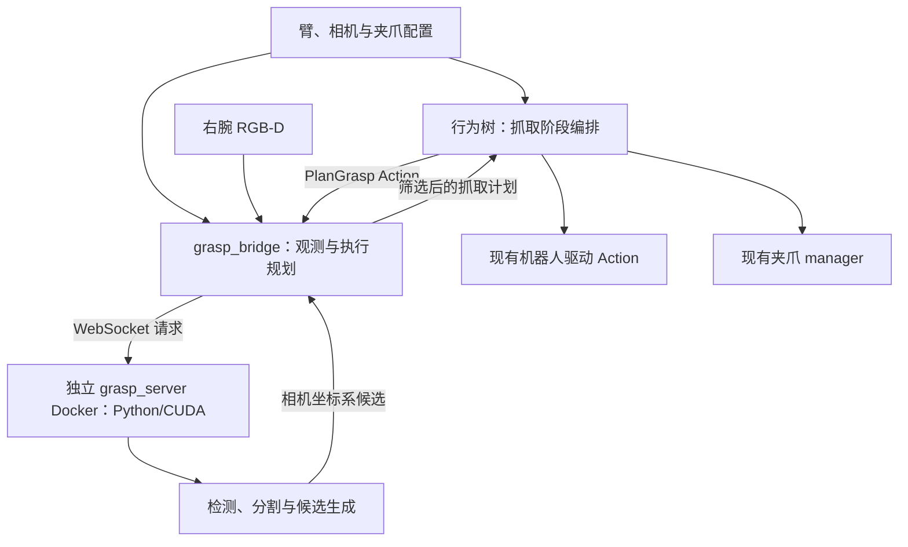

# 项目计划：独立抓取算法服务与右腕相机抓取

状态：**首版软件实现与无运动回归完成；P0–P2 外部前提待验收，P6 实机验收未开始**。

更新日期：2026-10-20。

本计划将参考项目的抓取算法接入 realman_pi，以右臂完成首个实机闭环，并保留以后换臂的能力。用户已明确许可清理 Git 后实施，并要求先更新本地 main、再从 main 创建实施分支。原分支 `feat/multi-station` 已快进合入本地 `main`（`7c87321`），随后从该提交创建 `implement` 分支；本轮实现仍未提交，也未推送远端。软件验证不触发真实硬件运动。

当前确认的范围：用户已允许修改 `camera_config.py` 的帧同步硬覆盖，并要求将三臂联合标定改成左右臂依次单臂标定、取消中臂标定。算法 Docker 采用纯 Python/CUDA 环境，通过 WebSocket 通信，ROS 2 集成由机器人侧 bridge 承担。P0–P5 已获许可，真实运动仍须单独操作决定。

## 1. 目标与首版范围

- 算法层运行在独立的纯 Python/CUDA Docker 容器中，通过 WebSocket 提供“观测 + 目标条件 + 夹爪几何 → 多个抓取候选”的服务；算法镜像不安装 ROS 2。
- 首版使用右臂 `r`、右腕 `camera_right`，以静态桌面、停稳采集、单次推理、单次抓取为工作方式。
- 首个实机目标：观察 → 采集 → 规划 → 接近 → 闭合 → 提起并保持 → 确认抓取结果。确认后通过预设位置完成受控放回；首版不增加任意目标放置规划。
- 标定仅要求右基座、右法兰、右腕相机与右工具之间的闭环，不依赖 global 相机、多臂相对基座标定或全局场景重建。
- 标定流程整体改为左右臂依次独立进行：先右臂、后左臂，每臂单独采样、求解、验收与保存，右臂不等待左臂完成。移除中腕相机/中臂标定和三臂联合流程；中臂现有运动、模型及夹爪功能保留。
- 机械臂选择、手眼外参、TCP、运动接口、可达性与执行归机器人侧；算法服务复用同一镜像与协议。
- 后续换臂时补齐并验证相应执行配置、标定和夹爪几何；不承诺只改臂名称就能直接实抓。
- 首版不实现双臂同时抓取、自动换臂、连续视觉伺服或通用场景碰撞规划。

## 2. 已核实的现状与约束

核查基线：realman_pi `a46eb183b91978a51d0efcc7fda58115bb07948c`；参考仓库 `../chaung_wei_2_jiao_fu` 的 HEAD 为 `5e80c6f845ff0c102648ecff4d31b624c830e9d4`。两个提交号用于定位来源；当前工作区的未提交文件也已纳入现状判断，不能将其当作干净提交快照。

| 现状 | 对实施的影响 | 主要依据 |
| --- | --- | --- |
| 右腕相机是 Gemini 305，序列号 `CV2856D0002E`，已配置 RGB 与原始深度 | 需验证真实 D2C 配准、时间配对及匹配的内参，不能用 resize 代替配准 | `config/ros/cameras_ros2.yaml` |
| `camera_config.py` 强制 `enable_frame_sync=False` | 用户已允许修改：改为有默认值且支持逐相机 YAML 覆盖，验证右腕能力后启用；仍需时间戳配对、停稳采集和真实 D2C 配准 | `src/sensor_bringup/scripts/camera_config.py` |
| 当前实际无中腕相机，但标定配置、校验和采集存在三臂硬编码 | 按用户要求替换为左右臂依次单臂流程，取消中臂标定；完整调整配置、采集、求解、会话、Web 与存储 | `src/sensor/realman_camera_calibration/`、`config/ros/camera_calibration.yaml`、`src/driver/realman_web_control/` |
| 左右 42D 共享总线，仅支持全开/全闭，位置是兼容端点 | `width_m` 用于候选可行性判断；不得用位置数值推算实际开口或抓稳状态 | `config/ros/gripper.yaml` |
| 显示夹爪模型不等于真实 42D，配置中 TCP 数值也需实测验证 | 实机前确认开口、指爪包络、安装方向、夹持中心和 TCP | `config/ros/end_effectors.yaml`、`realman_coordinates.yaml` |
| 已有 `ExecuteMotion` 的 MOVEJ/MOVEL/MOVEJ_P 和 `SolveIk` | 复用 ROS 驱动接口，算法与 BT 不直接调用 RealMan SDK | `src/driver/realman_msgs/` |
| `approach_and_grasp.xml`、`pick_task.xml` 是模板，缺少已注册叶节点 | 新建可运行 `grasp.xml`，同步实现节点、注册、端口、启动元数据和测试 | `config/behavior-trees/`、`src/behavior/realman_bt/` |
| 当前没有完整场景碰撞规划器 | IK 成功只表示末端可达；首版限定工作区、其他臂停放位和预验证接近/撤离走廊 | 当前 motion/BT 架构 |
| 工作区已有夹爪、配置和手册等未提交改动 | 保留现有改动，实施时逐处合并，不整文件覆盖或回退 | 本轮 `git status` |

相机由宿主机已安装的官方 `orbbec_camera` 二进制驱动启动。实施优先调整本项目的参数传递与采集桥，不修改厂商源码。部分 skills 的相机/夹爪描述早于当前硬件变化，具体拓扑以当前配置和实现为准。

## 3. 组件边界



### 3.1 算法服务

- 推理核心、协议与服务均采用纯 Python，镜像仅安装算法及 WebSocket 所需依赖。输入不要求 `r/l/m` 或机器人基座坐标；容器不包含 ROS 2、机器人控制 SDK、串口映射或运动客户端。
- 从参考仓库提取检测、分割、点云处理、物体策略和候选生成的必要代码，不整体搬入旧的在线 `grasp_hybrid_server.py`。
- 几何后端先作为右臂流程的默认后端；Contact-GraspNet 通过同一后端接口接入并独立验收，可显式关闭。
- 仅返回属于指定目标的候选；CGN 未归属目标的场景候选不能自动混入。
- 做物体与局部夹爪的几何筛选；整机可达性、基座关系和路径执行留给机器人侧。

#### 算法运行环境与 ROS 边界

- 独立构建 Python/CUDA 推理镜像，锁定 Torch、NumPy、OpenCV 与模型依赖，不继承现有 driver/RViz 镜像。
- 参考 `inference_worker.py` 自身不依赖 `rclpy`，可提取其算法代码并通过 WS 暴露服务；旧在线服务中的 ROS、硬件和编排逻辑由本项目既有组件承接。
- 图像采集、拍照时刻 TF、IK、ROS 诊断和候选可视化由机器人侧 bridge 负责，算法容器只处理请求中的不可变观测并返回结果与诊断数据。
- 算法服务只需 WS 网络连接和 GPU 运行环境，独立启动或离线回放均不要求机器人 ROS 图在线。

### 3.2 机器人侧 grasp_bridge

- 配对并验证 RGB-D，保存拍照时刻 TF、相机与配置身份，建立不可变 observation。
- 作为 WS 客户端请求候选；完成坐标转换、夹爪适配、IK 与受限路径验证，形成抓取计划。
- 通过长任务可取消的 `PlanGrasp` Action 提供规划能力；该 Action 不发送机械臂运动或夹爪命令。
- 规划反馈包含当前阶段、候选数量和拒绝原因；错误不能降级成一个伪造可执行姿态。

### 3.3 行为树与硬件驱动

- BT 是抓取阶段的唯一编排者；bridge 与算法服务不再维护第二套“移动—闭合—抬升”状态机。
- 复用 `/<arm>/execute_motion`、`/<arm>/solve_ik` 和夹爪 manager；补充所需 BT 叶节点。
- 不复用 VLA 的动作 chunk、速度 dispatcher 或 `policy` 模式语义。首版为独立单次任务树。

## 4. 配置与换臂设计

所有新增权威配置放在根目录 `config/`，解释单位、范围、硬件前提和相互引用。以下文件已纳入实现，现场测量仍通过未验收模板与本地覆盖管理。

| 配置 | 内容与归属 | 拟定位置 |
| --- | --- | --- |
| `ArmProfile` | 臂 ID、base/flange、工具引用、相机/夹爪关联、观察位、放回位、工作区、接近/抬升参数与速度 | `config/ros/grasp_profiles.yaml` |
| `CameraProfile` | 相机 namespace、序列号、图像/内参话题、光学 frame、配准方式、时序阈值、标定引用 | 与 `grasp_profiles.yaml` 中的相机表关联现有 `cameras_ros2.yaml` |
| 手眼外参 | 经过验证的安装变换、标定版本、设备身份与采集 provenance；原始样本仍留日志目录 | `config/ros/camera_extrinsics.yaml` |
| `GripperSpec` | 工具类型、有效开口、手指/掌部几何、夹持参考系和后端兼容条件；传给服务端的是几何子集 | `config/grasp/gripper_specs.yaml` |
| 物体策略 | 类别、候选抓法、物体局部取点规则；将硬件尺寸与图像分辨率阈值拆开 | `config/grasp/object_policies.yaml` |
| 服务/模型 | 后端开关、队列与消息限制、模型身份、权重哈希、输入范围及服务运行参数 | `config/grasp/server.yaml`、`models.yaml` |
| bridge | WS 地址、超时、选用 profile、规划与诊断设置 | `config/ros/grasp_bridge.yaml` |

- TCP 和控制器工具选择继续引用 `config/ros/realman_coordinates.yaml`；夹爪控制继续引用 `gripper.yaml`，不在新 profile 中复制第二套数值。
- 每次任务开始解析并冻结一个完整 profile，之后不能悄悄切换臂、标定或夹爪。
- 首版先验收右臂抓取配置；当前左右模板均未完成物理验收，左臂完成独立标定与硬件验收后再启用。中臂不列入本次相机标定/抓取 profiles；其他未来执行臂仍需独立配置和标定，不能复用右臂外参或默认硬件尺寸。
- 换臂使用同一服务、bridge 和 BT 代码。启动预检、Action namespace、相机、夹爪映射和所需臂集合都从所选 profile 一致派生。
- 换夹爪需要验证后端的几何假设；首版候选参考系针对已验证的夹持方式，不能承诺支持任意末端工具。

## 5. WebSocket 与候选契约

### 5.1 传输与请求

借鉴现有 `policy_bridge` 的 WebSocket + MessagePack/NumPy 二进制编码，提取或复用合适的传输逻辑；保持抓取业务接口独立，不复制 VLA 的动作执行逻辑。

- 握手返回协议版本、ready 状态、可用后端、模型/配置身份及服务能力。模型未就绪时不接受执行性请求。
- 请求至少包含 `task_id`、`request_id`、`observation_id`、任务 generation、观测时间戳、配置身份、目标条件和后端选择。
- 图像契约为对齐的 BGR `uint8[H,W,3]`、米制深度 `float32[H,W]`、与输出图像分辨率一致的 K，以及明确的光学 frame。
- 携带以相机坐标表达的向上方向/支撑面信息和 `GripperSpec` 几何子集；臂名称至多作为日志元数据。
- 校验 dtype、尺寸、消息上限、有限数值、深度有效区间、时间差与内参一致性；不接收任意 Python 对象反序列化。

### 5.2 统一抓取参考系

定义右手 grasp/contact frame：原点为约定的夹持中心，X 为闭合方向，Z 为正向接近方向。所有候选以该观测的 color optical frame 表达，使用米和显式旋转约定。

- 每个候选返回 ID、所属观测/目标、`T_camera_grasp`、估计宽度、后端与评分信息、可用的几何质量指标。
- 几何与 CGN 各有 adapter，将原生参考系转换为公共契约；不能直接将参考项目矩阵的 translation 当作本机 TCP。
- 逐项验证旧几何的 `0.09 m` wrist offset、`90°` yaw 转换以及 CGN 的 `0.1034 m` hand depth。它们是待解释的后端约定，不能成为所有夹爪的通用安装参数。
- 校验旋转正交性、手性、接近轴符号、夹持中心、对称姿态及工具变换；候选集保留多种可行朝向供机器人侧筛选。
- 不跨后端直接比较未经标定的分数；默认显式选择后端。无候选是正常业务结果，不自动转成无依据的运动。

### 5.3 超时与取消

- 首版每任务一个在途请求，服务队列有界，拒绝积压后的过期观测。
- 超时、取消、断线、任务 generation 或 profile 变化都使旧结果失效；重连后不重放旧抓取。
- GPU 推理可能无法立即中断，允许计算完成，但其结果不能重新获得执行资格。
- 返回值必须匹配原请求、观测、模型/夹爪规格与配置身份；同时检查候选有效期和执行前场景/腕姿变化。

## 6. 几何算法的适配范围

参考 Worker 的 top-slice 已能接收向上方向，但图像轴、局部邻域、部分宽度估计与层级评分仍依赖 camera XY/Z；仅增加 `arm_id` 或传入 gravity 不足以支持不同腕姿。

- 首版为右腕定义接近俯视且经过验证的观察姿态范围，在入口检查视角，不对任意腕姿静默使用 camera-Z 兜底。
- 将需要物理方向的几何计算统一到支撑面/任务平面的三维基底；图像分割仍在像素平面完成。
- 像素阈值按用途区分：图像质量条件可以保留像素单位，物理开口、手指接触和避障距离改用三维几何或明确的尺度换算。
- 物体语义策略、夹爪尺寸和现场补偿分别归位；按当前自定义 YOLO 类别清单保留目标语义，不静默换成 COCO 模型。
- 参考离线结果可作回归素材，其“候选非空”不能作为实机成功率。左腕采集的回放也不能证明右腕标定正确。

## 7. 右腕标定、坐标链与夹爪

### 7.1 左右臂依次单臂 eye-in-hand

- 替换原三臂原子采集/联合求解流程。配置仅保留 `r/right` 与 `l/left` 标定映射，默认先右臂；每次选择一个臂独立采集、求解、验收与保存，不要求另一个臂或相机在线。
- 每个 session 固定臂、相机序列号、内参和安装身份，切臂新建或恢复该臂自己的 session。采集图像、CameraInfo 和图像时刻法兰 TF 的原子性仅在当前臂内保证；样本计数、失败与结果分别管理。
- 复用 ChArUco 检测和 `solve_hand_eye`。每个单臂会话期间标定板相对该臂基座保持静止；换臂后可重新摆板，因此左右结果不能用于推导臂间布局。不求解多臂相对基座、不写回 `three_robots.yaml`。
- 配置校验、capture/solve 请求、健康判断、会话恢复、launch 与持久化完整改造。求解明确绑定 session 与单臂身份；原有 `all_arms_solved` 等返回语义同步调整，不保留要求三臂全部就绪的隐式门槛。
- Web 标定页增加左右臂选择和单臂状态/会话/结果，移除中臂和“三臂同时采样/求解”入口；Web 协议、ROS 消息与相关调用方一起更新。
- 旧三臂会话作为历史数据保留并标记来源，不静默混入新会话。需要复用旧样本时仅显式导入所选臂、验证设备与几何身份后创建独立会话，不直接复用旧联合结果。
- 记录相机序列号、内参身份、法兰 frame、工具/安装信息与求解方法；重装相机或改变相关几何后使旧标定失效。
- 使用保留样本及不同工作区位置/腕姿验证精度。现有 `0.050 m` 残差上限不能直接作为抓取精度验收标准；实际误差阈值根据实测指爪、物体和夹持余量确定，阈值未配置或未通过时禁止实抓。

### 7.2 右腕帧同步与配准

- 按用户许可，移除 `camera_commands()` 中 `enable_frame_sync=False` 的无条件覆盖，改为配置默认值和逐相机覆盖，并验证布尔类型、参数透传和其他相机的默认行为。
- 区分同设备 RGB-D 帧同步、跨设备 `sync_mode`、外部触发及 D2C 空间配准；开启帧同步不等于完成配准或图像/TF 时间匹配。首版只按右腕设备能力配置 RGB-D，不要求左右相机硬件同步。
- 无论驱动是否启用帧同步，bridge 都检查图像时间差、CameraInfo、观测新鲜度和停稳条件；设备不支持时明确报告，并在验证过的时间配对模式下运行。

### 7.3 TF 与工具一致性

约定 `T_A_B` 将 B 中的点转换到 A。令 C 为 color optical frame，F 为拍照时刻法兰，G 为公共 grasp frame：

```text
T_base_tcp = T_base_F(t_capture) × T_F_C × T_C_G × T_G_tcp
```

- 在采集时保存完整变换和配置版本；响应到达时不重新取最新腕部 TF 替换它。
- 持久安装 TF 保留相机驱动内部 camera-root → optical 链，必要时换算到相机根节点连接；每个 frame 只能有一个 parent/发布权威。
- 公共夹持参考系与真实 TCP 的关系由已测量的工具几何和安装方式确定；与驱动实际选用工具保持一致，并验证是否存在重复补偿。
- 执行前再次检查腕姿漂移、消息有效期与标定身份；不满足时重新观测，不继续执行旧计划。

### 7.4 42D 控制与结果验证

- 使用现有 `gripper_right` ROS 名称和 manager，保留共享总线及左右地址串行化；不新增串口访问者。
- 先确认真实最大开口、指爪形状、夹持中心与 TCP；网页显示模型不能作碰撞模型依据。
- 抓取阶段仅使用明确的全开/全闭能力，估计宽度只用于筛选；不把兼容位置、电流或 `torque_reached` 当作未经验证的抓稳证据。
- 首轮提起后通过视频/视觉或人工确认并记录成功/失败。命令返回成功只说明命令阶段完成，不能直接报告物体已抓稳。

## 8. 控制权与行为树执行

首版计划树：获取任务控制权 → 夹爪准备 → 观察位 → 停稳 → PlanGrasp → 接近 → 抓取位 → 闭合 → 提起/保持 → 验证 → 受控放回/结束。

- 任务控制权覆盖观察、推理、夹爪和机械臂运动全过程。现有每段 motion Action 的独占不能保护推理或夹爪阶段。
- 优先复用并最小扩展现有 driver/coordinator 的 admission 边界，设计按臂的任务 lease/token；所有运动入口及对应夹爪命令均检查同一控制权。无抓取任务时保留原调用语义，有租约时拒绝不属于任务的写命令。
- P0 固化 lease 获取、续期、释放、失联与主动接管契约。不能仅依赖 BT 容器锁、停用网页按钮或 bridge 内部 mutex。需要扩展 ROS 消息/夹爪任务命令接口时同步更新调用方和兼容测试。
- 用户接管或 halt 时先阻断后续阶段、使计划失效，再取消所持动作；未确认终止的运动不能因 lease 到期就允许新任务接管。
- 对已经发出的 42D 一次性命令记录其真实状态；取消不代表撤销硬件命令，也不自动松开已持物体。
- 新叶节点拟包括 `PlanGrasp`、通用笛卡尔运动、夹爪命令、任务控制权及验证节点；确切 tag/端口在 P0 固化，并在 executor 显式注册。
- `dry_run=true` 为默认值：校验配置并输出诊断，不创建运动 Action client、不发送目标或夹爪硬件命令。真实观测/推理的无执行验证另设明确入口，避免把配置 dry-run 与实景规划混淆。
- 保留 pending goal response、取消 drain、失败原因、一次性终态与重复运行约定；取消提交成功不等于机器人已物理停止。

## 9. 分阶段实施与验收

以下按实际交付更新；勾选仅表示该行软件或离线验证完成。P0/P1 物理输入、真实 RGB-D 和可选 CGN 运行验收仍单列待办。P6 的真实运动另需明确的操作决定，不因代码完成而自动执行。

### P0：固化契约和运行前提

- [x] 清点参考代码、模型、版本与运行依赖，记录来源提交、权重哈希与首批自定义类别。
- [ ] 完成参考仓库及自定义权重的许可证/再分发授权确认；当前未发现算法目录的完整授权说明，不把依赖的许可证等同于自定义权重授权。
- [x] 固化 profiles、公共 grasp frame、WS schema、`PlanGrasp` Action/结果，以及任务控制权接口。
- [x] 固化左右臂单会话标定、旧会话兼容与 Web/ROS 返回语义，以及机器人侧 bridge 的诊断/可视化输出。
- [x] 列出夹爪/TCP、工作区、观察位、载物返回路径/释放位和标定精度的必需输入，建立未就绪模板与执行前拒绝门槛。
- [ ] 取得并审批这些实测输入；未取得值时不写入假定生产值。
- [x] 定义候选有效期、时序/姿态变化阈值和失败类型，将参数放入有注释的权威配置。
- [x] 建立离线样例：有效候选、无目标、无效深度、过期观测、错 frame、错误模型/夹爪身份。

验收：接口和配置无未解释的坐标/单位；每项物理假设有测量来源或明确未就绪状态，待实施范围可以独立审阅。

### P1：右腕 RGB-D 与左右臂依次单臂标定

- [x] 实现原始光学外参 D2C 重投影、图像/深度/CameraInfo 配对、颜色编码与深度单位转换，合成投影与遮挡回归通过。
- [ ] 使用真实右腕数据验证设备光学 TF、配准质量与时间配对。
- [x] 修改已获准的同步硬覆盖：支持逐相机 YAML 设置 `enable_frame_sync`，参数/类型/默认行为回归通过。
- [ ] 检查 Gemini 305 实际帧同步能力，再决定是否在本地配置启用。
- [x] 删除标定配置/校验/采集中的中臂及三臂联立要求，改为左右臂依次独立的配置、采集、求解、外参持久化和 TF 接入。
- [x] 更新 Web 选臂、单臂健康/样本/会话/结果，ROS/Web 接口及 launch；取消求解后自动写回多臂布局，保留历史数据并验证隔离。
- [x] 用合成变换/离线样例验证两个臂分别求解、切臂会话隔离、另一臂离线可用、拒绝中臂请求、采集时间与 TF 链。

验收：可独立使用右腕生成符合算法契约的 observation；左右标定均可逐臂运行且不等待另一臂，无中臂依赖或跨臂样本混用，TF 无冲突。右臂先做真实采样与精度验收，左臂不阻塞右臂抓取上线。

### P2：算法服务、协议与独立 Docker

- [x] 建立不依赖 ROS 的推理核心、协议/数据验证包和 WS 服务；先提供无模型依赖的 mock server。
- [x] 提取 YOLO → MobileSAM → 受限顶面/PCA 几何候选链路，拆分物体策略/夹爪规格，完成公共 frame adapter 与视角约束；未迁移全部旧物体策略。
- [x] 接入 CGN adapter 与显式 capability 开关；缺失权重或依赖时报告不可用。
- [ ] 提供并验证兼容 CGN 依赖、checkpoint/config 哈希及真实运行；当前默认不可用。
- [x] 固定模型 manifest/hash 与依赖；以参考已验证的 Python 3.10、Torch 2.7.1 + CUDA 12.6、NumPy 1.26.4 为核查起点，再验证目标宿主 GPU 驱动兼容性。
- [x] 建立纯 Python/CUDA 独立 Docker/Compose opt-in 服务，验证 Python、Torch/CUDA、NumPy/OpenCV 及模型依赖兼容性；不安装 ROS 2，运行不要求 ROS 图在线。
- [x] 权重只读挂载、无 USB/串口映射、无需特权；与现有 driver/RViz 镜像分别构建和锁定依赖。
- [x] 模型作为外部运行产物管理；运行不依赖相邻参考仓库的绝对路径，不把大权重提交 Git。

验收：mock 和有模型离线回放均可通过 WS 完成请求/结果；算法镜像无 ROS 2 依赖，脱离 ROS 图仍可独立工作。构建可复现，模型身份可追踪，超时/取消/断线/队列边界可验证。

### P3：机器人侧规划桥

- [x] 实现 `PlanGrasp` Action：采样 → WS → 公共 frame 校验 → 拍照时刻坐标转换 → 多候选筛选 → 抓取计划。
- [x] 以当前关节为 seed 使用选定臂的 IK；验证预抓取、抓取、提起/撤离阶段，保存拒绝原因。
- [x] 实现工具/夹爪适配、受限工作区与走廊检查，明确当前路径检查能力的边界。
- [x] 校验 task/profile/observation/标定身份、候选有效期和执行前漂移，取消后不再输出可执行计划。
- [x] 新增只做真实观测与规划的入口，输出候选叠图、坐标轴和计划诊断，不调用执行接口。
- [x] 由 bridge 将服务端诊断与候选结果转换为机器人侧 ROS 诊断/可视化输出。

验收：mock ROS 图及离线数据能验证坐标链、多候选选择和错误路径；同一观测/目标/夹爪输入不因调用臂名称改变算法候选，机器人侧可达性可导致不同选择。

### P4：任务控制权与可运行抓取树

- [x] 完成全过程任务控制权，并测试 Web/Pika/VLA/其他任务在推理间隙和夹爪阶段的冲突处理。
- [x] 实现并注册叶节点，补齐构建、端口、blackboard、反馈/取消 drain 与诊断。
- [x] 新建 `config/behavior-trees/grasp.xml`；复用现有 `./rm65 bt` 启动与归档流程，默认选右臂、默认 dry-run。
- [x] 启动器按 profile 校验/派生所需臂和 Action，避免换臂后仍预检 `/r` 或误要求三臂。
- [x] 校验配置 dry-run 不发硬件命令；以 mock 验证完整顺序、每阶段失败、接管、重入和重复执行。

验收：所有 XML tag 均已注册；模拟完整成功/失败流程可审计；任一阶段失败不继续后续动作，无旧响应触发或交错控制。

### P5：文档、回归与可部署交付

- [x] 更新新增功能手册、左右依次单臂标定、帧同步、纯算法容器与 ROS bridge 的 WS 边界、BT、启动/部署以及受影响的夹爪说明。
- [x] 同步 ROS 接口表、配置表、命令表、开发索引、侧栏和新增页面路由测试。
- [x] 新 BT 节点同步网站 BT catalog/节点说明，保持现有可视化和运行快照契约。
- [x] 运行针对本改动的协议、几何/变换、相机/标定、ROS/BT、取消与控制权测试；检查既有 VLA、Pika 和夹爪行为。
- [x] 完成镜像构建、离线回放、默认 dry-run、网站风格检查/构建，并记录未能运行的环境相关项。

验收：代码、权威配置与手册一致；右臂操作前提与未就绪项可见；已通过的离线检查有记录，未做的实机验收不标为完成。

### P6：右臂实机分步验收

- [ ] 明确许可、现场清场和急停条件；确认目标 Action 各只有一个 server、其余臂停放、控制权独占。
- [ ] 确认右腕配准、右臂手眼误差、真实指爪/TCP、工具选择及各物理阈值已验收。
- [ ] 先真实观察/规划，再低速空走接近与撤离，检查整个臂和指爪路径；之后才执行闭合与短距离提起。
- [ ] 首次完成抓起/保持/受控放回后，对预先记录的对象位置与朝向重复验证，逐次标注结果和失败阶段。
- [ ] 分别报告检测、有效深度、候选、IK/路径、闭合与提起成功情况；不以“有候选”或“命令成功”替代抓取成功。
- [ ] 在相同右腕数据集上比较几何/CGN，再依据实际表现决定是否切换默认后端。

验收：右臂在约定物体、观察姿态和工作区内完成可重复闭环，记录实测成功率与失败样例；左臂抓取待其独立标定与硬件验收，中臂不在本次相机标定/抓取范围。

## 10. 预期文件范围

以下是当前组件与文件归属；接口已固化，实际修改以分支 diff 为准。

| 类型 | 路径/内容 |
| --- | --- |
| 新增纯 Python 包 | `src/grasp/grasp_protocol/`、`src/grasp/grasp_server/`；协议验证、候选约定、后端 adapter、WS 服务与各自测试 |
| 新增 ROS 包 | `src/grasp/grasp_bridge/`；采样、WS 客户端、坐标/规划、Action server、ROS 诊断/可视化、launch 与测试 |
| ROS 消息与任务控制接口 | `src/driver/realman_msgs/` 的 `PlanGrasp.action`、候选/计划消息，以及经 P0 确认的 lease 契约；必要时扩展夹爪任务命令接口 |
| 现有机器人/夹爪边界 | driver coordinator/admission、gripper manager；仅增加所需控制权兼容逻辑，不重写现有硬件协议 |
| 标定与相机桥 | `src/sensor/realman_camera_calibration/`、`src/sensor_bringup/`、`config/ros/camera_calibration.yaml` 及对应测试；移除中臂/三臂联合标定、修改帧同步透传 |
| 标定接口与 Web | `src/driver/realman_msgs/srv/` 下标定消息；`realman_web_control` 的 protocol/node/server、标定前端、单臂会话/结果及相应测试 |
| BT | `src/behavior/realman_bt/` 的节点/注册/launch/测试、`config/behavior-trees/grasp.xml`，必要时调整元数据解析/容器启动器 |
| 权威配置与构建 | `config/grasp/`、`config/ros/grasp_*.yaml`、外参配置；`config/docker/grasp-server.Dockerfile`、现有 Compose、`config/python/grasp-*-requirements.txt` |
| 启动集成 | `src/realman_bringup/launch/system.launch.py` 和现有入口的最小必要调整；算法服务保持 opt-in |
| 操作手册 | 新增 `website/docs/development/grasping.md`；更新标定、BT、启动/部署、相关架构和 reference 页面 |
| 网站索引与契约 | `website/docs/development/index.md`、`config/website/vitepress.config.mts`、`website/tests/site.spec.ts`、BT 节点说明；只有新增构建输入时才补相应部署触发路径 |

## 11. 验证要求与记录

以下是本轮实施的验证契约；已通过证据见第 13 节，真实硬件部分仍未执行：

- 协议：消息往返、dtype/shape/单位、身份匹配、过载、超时、断线、取消与迟到响应。
- 几何：公共 frame 与工具变换、支撑面/视角变化、候选对称性、真实宽度限制、目标归属；用可解释的合成场景检验坐标关系。
- 标定：左右分别独立采集/求解、另一臂离线、拒绝中臂、切臂会话与旧数据隔离、Web/ROS 身份语义、拍照时间 TF、持久外参、单 parent、留出样本误差；重装或错误设备身份不能继续使用旧标定，不再回归三臂联合执行。
- 相机：同步参数逐相机透传与默认值、RGB-D 时间差、D2C 配准和对应 CameraInfo；不能将帧同步开关通过等同于输入质量验收。
- 机器人侧：不同 profile 的 namespace/相机/夹爪解析、IK 选择、路径边界、lease 全周期、阶段失败/接管/重入，以及 zero-hardware-command 的 dry-run。
- ROS：在 Humble 环境 `colcon build/test` 受影响包，运行相关 mock 与 BT/XML 测试；新增 Python 遵循根 `config/python/ruff.toml`。
- 部署：`docker compose config --quiet`、纯 Python/CUDA 算法镜像构建、模型 ready/回放、无 ROS 图独立 WS 运行及依赖兼容；入口有改动时检查 `bash -n rm65`、`zsh -n functions.zsh` 及对应 launcher 测试。
- 网站：按相关 site skills 运行 style gate、`npm run build` 和受影响的路由/BT 页面测试；不在计划阶段将未完成能力写为当前产品功能。
- 日志：机器人侧 ROS 节点使用官方 rclpy/rclcpp 日志，保留 `RCUTILS_COLORIZED_OUTPUT=1`、`ROS_LOG_DIR` 与节点日志。纯 Python 推理核心/WS 进程使用标准结构化日志；推理样例、候选叠图和任务结果按运行 ID 归档到 `logs/`，不提交权重、图像或日志产物。

每个实机任务记录观测 ID、相机/标定/工具/模型身份、候选及拒绝原因、选中计划、各阶段动作结果、取消/失败原因和人工/视觉结果。配置哈希不代替实际精度验证；测试通过不自动授权实机运动。

## 12. 已阅读的 skills 与应用范围

已完整阅读本会话列出的 16 个 `SKILL.md`，并补读文件系统中发现的 `review-agent`，合计 17 个。仅应用与任务相符的工作流；阅读不触发安装、生成图像、发布网站或刷写硬件。

| Skill | 在此计划中的作用 |
| --- | --- |
| `realman-pi-architecture` | 组件、启动、驱动所有权与现有工程边界；旧硬件信息按当前实现校正 |
| `developing-realman-behavior-trees` | 长任务 Action、节点注册、XML 元数据、dry-run、取消、运行快照与实机许可边界；已读其五份相关 references |
| `developing-changingtek-grippers` | 保持 manager/串口所有权与接口边界；当前左右 42D 能力以实际配置为准 |
| `realman-python-driver` | 复用既有 ROS/SDK 边界、显式单位与错误语义；已读 `doc/README.md`，涉及具体 SDK 新行为时再查对应官方资料 |
| `project-config-layout` | 新配置与构建配置统一放根 `config/`，带解释性注释，避免重复权威值 |
| `ros2-logging-conventions` | ROS 官方日志、时间目录与 Docker 挂载 |
| `document-feature-updates` | 实施阶段同步功能手册、索引、参考表与构建验收 |
| `realman-site-components` | 实施阶段新增手册页采用既有文档组件与图表约定 |
| `realman-site-design-system` | 实施阶段保持网站样式并运行 style gate |
| `realman-site-deploy` | 实施阶段网站构建与新增构建输入的触发路径；本计划不发布网站 |
| `debugging-pika-teleop-two-ends` | 了解现有 Pika 输入边界，纳入控制冲突/兼容验证；本任务不调整两端遥操作部署 |
| `review-agent` | 了解只读、可证实问题的审查约定；当前交付为计划文档 |
| `imagegen`、`openai-docs`、`skill-creator`、`skill-installer`、`esp-idf-device-loop` | 已读；不涉及其图像生成、OpenAI 产品查询、skill 修改/安装或 ESP32 固件工作流 |

## 13. 当前完成状态

- [x] 阅读全部已列出 skills 与补充发现的 skill，核对相关工程约定。
- [x] 只读检查当前项目、参考算法、右腕/标定/夹爪与 BT 边界。
- [x] 将方案、阶段、文件范围与验收条件写入项目级 `PLAN.md`。
- [x] 根据审阅意见修订帧同步、左右依次单臂标定，确认算法 Docker 采用纯 Python/CUDA + WS。
- [x] 用户明确许可开始 implement；完成本地 main 快进与新建实施分支。
- [x] P0–P5 已实现范围的软件实施与无运动回归；各阶段未勾选验收项保持待办。
- [ ] 实机运动许可与 P6 验收。

软件交付证据（2026-10-20）：算法协议/服务 26 项测试通过，最终独立 Docker
镜像通过 Buildx 构建、GPU/WS smoke 和 SIGTERM 验证；正向模型回放使用真实参考彩色图，
但深度、内参与夹爪几何是明确标注的合成输入，不能证明真实注册 RGB-D 或抓取精度。
grasp_bridge、主机相机与相关规划回归 103 项通过；标定与 bringup 回归 34 项通过，
Web 控制 Python 回归 247 项无 skip；最终算法/bridge/标定/bringup/Web/主机相机综合回归
384 项通过。BT CTest 35/35、任务控制权/配置 Python 回归 263 项、隔离 Docker ROS
driver/夹爪测试 83 项通过；延迟 endpoint 回归确认计划过期后不提交抓取运动或夹爪闭合请求。
上述套件覆盖范围有重叠，不累计为独立测试总数。标定桌面/移动 Playwright 10 项通过；网站 style gate、
VitePress build 与受影响的文档/BT Playwright 检查通过；项目 Ruff 检查通过。
安装后的 `system.launch.py` bridge-only dry-run 已验证，未创建传感器、TF、IK、租约客户端。

仍未完成的输入：参考算法/自定义权重的授权确认、真实右腕 RGB-D 配准与时间质量、设备帧同步
能力核验、左右独立手眼实测与精度验收、真实 TCP/夹爪
几何、观察/返回走廊和工作区测量、真实记录 RGB-D 回放，以及 Contact-GraspNet 兼容依赖/权重。
生产 profiles 保持 `verified: false` 和空测量值并 fail closed；几何后端是有边界的顶面/PCA
启发式，不等同于参考项目全部物体策略或完整场景碰撞规划。下一步只进入 P6 前置测量和审阅，
不因软件测试通过而自动执行实机运动。
