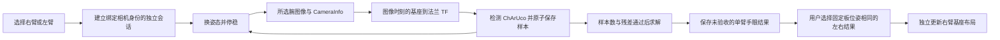

# 单臂腕相机 ChArUco 手眼标定

`realman_camera_calibration` 位于 `src/sensor/`，订阅腕相机图像、`CameraInfo` 和机械臂法兰 TF，通过 ROS service 采样与求解。默认先右臂，再切换左臂；每次请求只处理一臂，另一臂或相机离线不影响当前会话。中臂不参与相机标定，中臂的运动控制仍保留。

话题、TF、相机安装身份、标定板尺寸和误差阈值由 [`config/ros/camera_calibration.yaml`](https://github.com/QingTianRobot/realman_pi/blob/main/config/ros/camera_calibration.yaml) 管理。当前使用左右腕 Gemini 305，前后全局相机不参与本流程；设备配置见[相机指南](../guide/cameras)，抓取集成见[腕相机抓取](./grasping)。

## 会话与坐标约定

每个会话绑定一个 `arm_id`、相机 ID、配置的 `serial`、`mount_id`、基座/法兰/彩色光学帧和标定板哈希。第一张已接受样本还会冻结内参与内参哈希。相机重装后必须更新 `mount_id` 并重新采样；更换设备、内参、帧名或标定板后，旧会话不能继续采集。

同一个会话内标定板必须相对所选基座保持静止。移动机械臂到不同姿态，停稳后采样。若要从左右结果估计基座相对位置，两次会话的标定板必须保持同一物理位置；用户选择会话时负责确认这一点。

采样使用所选图像的 ROS 时间戳查询：

```text
lookup_transform(base_frame, end_effector_frame, image_stamp)
T_base_board = T_base_flange · T_flange_camera · T_camera_board
```

默认法兰帧为 `r/link_6`、`l/link_6`；彩色光学帧来自配置。`solvePnP` 得到 `T_camera_board`，OpenCV eye-in-hand 求解得到 `T_flange_camera`。结果字段仍命名为 `tool_to_camera`，但这里的 tool 明确指配置的法兰帧。矩阵为左乘列向量的 4×4 齐次变换，平移单位为米。



## 配置

实体标定板为 `CC200-15-11.25`：外形 200 × 150 mm，图案区域 180 × 135 mm，12 × 9 个棋盘格，大格边长 15 mm、marker 边长 11.25 mm，字典 `DICT_5X5_100`。这些值以 `camera_calibration.yaml` 中的 `board` 为准，不能在网页覆盖。

| 配置 | 含义 |
| --- | --- |
| `cameras.<id>.arm_id/serial/mount_id/optical_frame` | 将腕相机安装与单臂绑定；重装后更新 `mount_id` |
| `robots.<arm>.base_frame/end_effector_frame` | 采样时查询的基座和法兰帧 |
| `sampling.arm_order/default_arm` | 建议顺序与默认臂；默认 `[r, l]`、`r` |
| `sampling.minimum_samples_per_arm` | 当前单臂会话的最低样本数；配置默认为 30 |
| `sampling.maximum_message_age_sec` | Image 与 CameraInfo 的最大接收年龄，秒 |
| `sampling.maximum_timestamp_delay_sec` | 源时间戳相对节点时钟的最大延迟，秒 |
| `sampling.maximum_inter_camera_skew_sec` | 沿用原键名，现检查所选相机 Image 与 CameraInfo 的时间差，秒 |
| `sampling.tf_timeout_sec` | 查询图像时刻法兰 TF 的等待上限，秒 |
| `solver.maximum_hand_eye_residual` | 手眼方程残差门槛 |
| `solver.maximum_board_translation_spread_m` | 全部样本反算的固定板平移离散度，米 |
| `solver.maximum_board_rotation_spread_rad` | 全部样本反算的固定板旋转离散度，弧度 |

`sampling.required_arms` 已移除；配置不再接受中腕或重复相机绑定。支持仅配置右腕，也支持左右腕均配置但独立使用。生产相机的帧同步由设备能力和相机配置控制；本标定服务检查时间戳并使用图像时刻 TF，不依赖多相机同步。

## 两个 ROS service

### `CaptureCalibrationSample`

服务名：`/camera_calibration/capture_sample`

```text
string session_id
bool start_new_session
string arm_id
---
bool success
string session_id
string batch_id
string arm_id
uint32 sample_count
string sample_id
string image_path
string preview_image_path
string latest_image_path
string detection_status
string detection_message
string message
```

首次调用使用空 `session_id`、`start_new_session: true` 和 `arm_id: r`。后续请求使用返回的会话 ID、`start_new_session: false` 和相同臂。新建请求若同时带有非空 ID 会被拒绝。ROS 调用的空 `arm_id` 使用配置默认值；Web 协议要求显式传入 `r` 或 `l`。

服务只检查所选腕的消息健康状态、非零时间戳、配置的光学帧、分辨率和 ChArUco 角点，随后查询图像时刻 TF。通过后，一张原始 PNG、一张角点/坐标轴预览和样本 JSON 写入隐藏暂存目录，全部成功后才提交并增加计数。失败时尽可能保存最近画面供排查，返回检测或 TF 错误；不会写入一个可用于求解的半成品样本。

### `SolveCalibration`

服务名：`/camera_calibration/solve`

```text
string session_id
string arm_id
---
bool success
string session_id
string arm_id
uint32 sample_count
string result_file
string result_json
float64 mean_reprojection_error_px
string message
```

求解重新读取指定会话的 manifest 和全部已提交样本，验证臂、相机安装、帧、标定板与内参一致性，再检查最低样本数、手眼残差和固定板位姿离散度。采集与求解互斥，并发请求返回失败。没有采样上限，求解使用该臂全部已接受样本。

成功结果含 `schema_version`、`arm_id`、`identity`、内参/哈希、`calibration_id` 和 `hand_eye.<arm>.tool_to_camera`，保存在 `calibration_result.json`，同时通过 `result_json` 返回。默认 `verified_for_grasp: false`：手眼求解通过后仍需用留出数据与实测点验证抓取精度，再按[抓取配置](./grasping)登记验收后的外参。单臂 solve 不写回布局，`layout_updated` 保持 `false`；通过下面的独立服务应用两臂结果。旧的 `all_arms_solved` 和数组响应已移除；新增接口后需重建 `realman_msgs` 和调用方。

### `UpdateCalibrationLayout`

服务名：`/camera_calibration/update_layout`（配置项 `services.update_layout`）。

```text
string left_session_id
string right_session_id
---
bool success
string left_session_id
string right_session_id
bool layout_updated
string layout_backup_file
string message
```

由用户明确选择两个已求解的左右臂 session，并负责确认两次采样时标定板位置完全一致。无需布局组 ID，不自动匹配会话，也不要求重新采样。节点读取所选会话的 `calibration_result.json`，检查臂身份与矩阵格式，计算 `T_left_right = T_left_board @ inverse(T_right_board)`。

更新保持左臂布局不变，以左臂当前布局为参考写回右臂 `x/y/z/roll/pitch/yaw`，中臂保持原值。复用 `layout_update.py` 保留 YAML 注释，写入前生成同目录 `.yaml.bak`，随后原子替换；写回失败时 `success: false`。采样、求解、布局写回互斥。

`layout_config_file` launch/node 参数指定目标文件，默认与标定配置同目录的 `three_robots.yaml`；主 bringup 使用其实际加载的布局文件，Docker 中该目录需要可写挂载。更新影响下次 bringup，当前 `static_transform_publisher` 不自动重启。此服务只更新基座布局，不发布相机外参 TF，也不改变抓取验收状态。

```bash
ros2 service call /camera_calibration/update_layout \
  realman_msgs/srv/UpdateCalibrationLayout \
  "{left_session_id: 'session-...', right_session_id: 'session-...'}"
```

## 构建、启动与验证

在项目根目录执行：

```bash
source /opt/ros/humble/setup.bash
colcon build --symlink-install \
  --packages-up-to realman_camera_calibration realman_web_control
source install/setup.bash

export REALMAN_CONFIG_ROOT="$PWD/config"
export REALMAN_LOG_ROOT="$PWD/logs"
ros2 launch realman_camera_calibration camera_calibration.launch.py
```

节点不启动相机驱动；宿主机相机和所选机械臂 TF 应提前启动。launch 使用时间戳日志目录和 ROS 2 官方日志接口。

```bash
ros2 service call /camera_calibration/capture_sample \
  realman_msgs/srv/CaptureCalibrationSample \
  "{session_id: '', start_new_session: true, arm_id: r}"

# 移动到另一姿态并停稳，用返回的实际会话 ID 继续采样。
ros2 service call /camera_calibration/capture_sample \
  realman_msgs/srv/CaptureCalibrationSample \
  "{session_id: 'session-...', start_new_session: false, arm_id: r}"

ros2 service call /camera_calibration/solve \
  realman_msgs/srv/SolveCalibration \
  "{session_id: 'session-...', arm_id: r}"
```

结果路径为 `REALMAN_LOG_ROOT/camera_calibration/<session_id>/`，含 `session.json`、`attempts/`、`batches/` 和求解结果。重启后可恢复身份一致的单臂会话。历史三臂会话缺少该 manifest，保留文件供归档但拒绝恢复；不要修改样本 JSON 或拼接不同会话。

### 输入健康状态

节点发布 `/camera_calibration/diagnostics`（`diagnostic_msgs/DiagnosticArray`）和 `/camera_calibration/camera_health`（`std_msgs/String` JSON）。每路状态包含 Image/CameraInfo 是否收到、接收年龄、源时间戳延迟、两类消息时间差和分辨率：

- `healthy`：两类消息通过新鲜度、时间延迟和时间差检查。
- `missing`：缺少 Image 或 CameraInfo。
- `stale`：接收年龄超过配置阈值。
- `delayed`：Image 或 CameraInfo 时间戳延迟超限。
- `unsynchronized`：Image 与 CameraInfo 时间差超限。

诊断可以同时上报两腕，采样和页面只关注当前臂。若主机有帧但标定节点没有输入，检查宿主和 Docker 的 `ROS_DOMAIN_ID`、`ROS_LOCALHOST_ONLY=0` 与 `FASTDDS_BUILTIN_TRANSPORTS=UDPv4`；宿主 Orbbec 与容器 Fast DDS 的共享内存兼容问题见[相机指南](../guide/cameras)。

## Web 标定页面

启动 `realman_web_control` 后访问 `http://<工控机>:8765/calibration.html`，也可从控制页“相机标定”进入。页面通过已有 WebSocket 发送单数 `arm_id` 的 `capture_calibration_sample` 和 `solve_calibration` 消息，展示当前腕健康状态、采样计数、检测预览与最终 JSON。它不发送机器人运动命令。“更新双臂布局”分别列出已求解的左、右会话；选择后点击按钮，通过 `update_calibration_layout` WebSocket 消息调用上述服务，并显示备份路径和重启提示。

默认选择右臂。切换到左臂后，当前会话、预览和结果会清空，要求新建或加载左臂会话。请求进行中禁用切臂、加载、清理与删除操作，避免把结果关联到另一臂。预览通过 `/api/calibration/preview/<relative-log-path>` 提供，限定在日志根目录下的 PNG/JPEG。

历史列表来自 `GET /api/calibration/sessions`，响应包含 `session_id`、`arm_id`、`sample_count`、`recoverable`、`solved` 和创建时间。页面筛选当前臂，会显示旧格式会话但禁用加载。节点仍会对加载的磁盘会话做完整身份校验，列表中的 `recoverable` 只是格式检查。

刷新默认附带 `delete_empty=true`，仅清理没有已提交样本记录的空会话；非空旧格式或损坏记录会保留以便检查。显式选择会话并确认删除后，`DELETE /api/calibration/sessions/<session_id>` 会永久删除该会话的图片、样本和结果。接口只接受直接 `session-*` 子目录，拒绝路径穿越。保留数据应先归档到 `logs/camera_calibration/archives/`。

## 已知限制与测试

每个会话需要覆盖足够的平移与各轴旋转。满足最低样本数不代表可观测性充分，不要在同一个姿态反复采样替代不同姿态。标定板移动、相机安装松动、时间戳错误或末端帧选择错误，都可能导致结果不适合抓取；独立验收通过前保持 `verified_for_grasp: false`。

本接口仅适用于腕部 eye-in-hand 相机。固定全局相机需要独立的外参模型，不能套用该服务。

```bash
source /opt/ros/humble/setup.bash
PYTHONPATH=src/sensor/realman_camera_calibration:$PYTHONPATH \
  python3 -m pytest -q src/sensor/realman_camera_calibration/test
PYTHONPATH=src/driver/realman_web_control:$PYTHONPATH \
  python3 -m pytest -q src/driver/realman_web_control/test
cd website
npm run build:web-control
npm run test:web-control -- tests/web-control/calibration.spec.ts
npm run build
```

测试覆盖单臂独立采样/求解、图像时刻 TF、另一臂离线、身份不一致、并发拒绝、旧会话保留及左右臂页面切换；软件测试不替代实机手眼精度验收。
