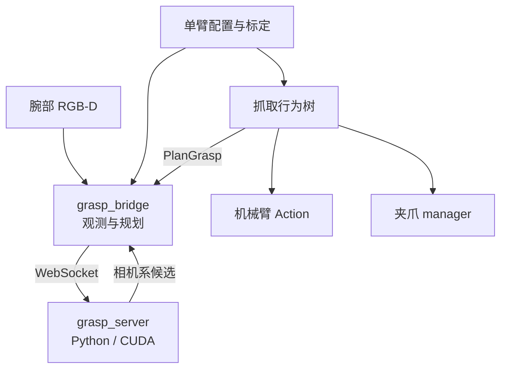
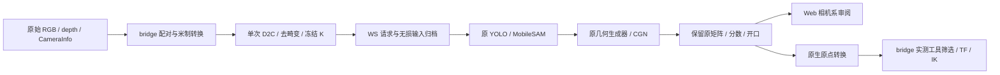

# 独立抓取算法与腕部规划桥

## 单帧 6D 位姿开发状态

`src/pose6d/pose6d/` 包含独立的单帧 6D 位姿服务，支持 FoundationPose 与 WAPR 两种后端、二值 mask 和 RGB-D 数据校验、原始 OBJ 轮廓与深度筛查、观测绑定、吸盘几何和服务端点动状态机。算法服务的二进制 WebSocket 使用 `grasp_protocol` 的有界 MessagePack 编码；模型由 OBJ 文件的 SHA-256 标识。筛查阈值未校准时返回 `insufficient_evidence`，不会把网络分数当作概率。筛查通过也不能证明位姿正确。

`config/docker/compose.pose6d.yaml` 和相邻 FoundationPose 仓库的 `docker/pose6d-server.Dockerfile` 定义独立 GPU 镜像，默认从相邻的 `FoundationPose` 目录读取构建源，并只读挂载权重与已登记的 OBJ。当前注册 `eu_plug` 和 `eu_plug_1124`；`/6d_pose.html` 提供“采集分割对象”“解算 OBJ”和“位姿算法”三个下拉框；算法可选 FoundationPose 或 WAPR，解算 OBJ 从 bridge 配置加载可用模型，默认选择 `eu_plug_1124`（`eu-plug-1124mtl.obj`）。一次采集和自动分割后，可以保留同一 RGB-D、实例和 Mask，反复切换 OBJ 解算。每次解算请求独立携带 object ID，server 按 ID 和 OBJ SHA-256 加载对应网格，GPU worker 每次只保留当前算法与网格运行时。两种算法共用 `register/result` WebSocket、模型 SHA-256 校验和同一历史归档；WAPR 的 `score` 是组级 `score_6d`，由 `score_type: wapr_score_6d` 标识。WAPR 的 `vis_score.png` 显示按 WBPS `within_group` 排序的前十候选，每行标注候选 ID、`within_group`、`between_group` 和组级 `score_6d`；前端明确标出这些分数的含义，不把它们当作 FP scorer logit。可通过 Compose 文件中的 `POSE6D_*` 变量调整来源；服务默认只绑定本机 WebSocket 8092 和历史 HTTP 8095 端口。算法服务、历史存储和查看页面均由 FoundationPose 仓库维护；本仓库保留 ROS 客户端和 `/6d_pose_history/` 同源代理。`eu_plug_1124` 的 4 个吸盘接触区域从 `eu-plug-1124mtl_grasps.json` 加载，通过 `annotation_object_id: eu-plug-1124mtl` 校验标注身份；解算后可审阅和选择吸取方式，并沿用工作区验证与人工复核流程。历史通过专用持久化 volume 保存，主页面和 `/6d_pose.html` 均提供入口。

ROS 包 `pose6d_bridge` 和 `/6d_pose.html` 实现采集、冻结观测、下载 RGB、上传单通道 8 位 PNG mask、单帧推理和相机系点云/OBJ/吸盘审阅。Mask 必须与下载 RGB 来自同一观测且分辨率一致；页面提醒操作者确认来源，系统不能从文件内容证明这一点。服务端预注册模型，请求传递模型 ID 与哈希。`pose6d_bridge` 在主 Compose 的 `pose6d` profile 中，参数位于 `config/ros/pose6d_bridge.yaml`。2026-11-10 已从真实 `/6d_pose.html` 页面完成 right wrist RGB-D 采集，RGB 与 Depth 为 848×530，frame 为 `camera_right_color_optical_frame`，标定状态为 `available`。

3D 预览以冻结的采集相机坐标系为原点；坐标轴按 X 红、Y 绿、Z 蓝显示。橙色箭头为朝外表面法向 `n`，青色箭头为标注原始切向参考 `tangent_ref_obj` 经物体旋转后的方向，接触系红色 X 轴为该参考在切平面上的归一化投影，+Z 为进给方向 `-n`。吸取方式下拉框选中哪个，就只显示该方式的吸盘、接触区域、法向、切向参考、坐标轴与标签；其他候选隐藏。紫色吸盘显示所选方式沿朝外法向偏移 40 mm 的准备位，并显示对应接触/TCP 坐标系。其 `T_camera_prepare_contact`、`T_camera_prepare_tcp` 由后端使用运动相同的坐标变换计算；后端同时计算准备位进给轴与 BASE 竖直向下 `-Z` 的有方向夹角，并用 TCP 和吸盘本体包络检查准备位 workspace。下拉框先列 workspace 合格项并按角度升序，未通过或无法判定的候选保留为灰色禁用项，并显示警告原因；角度与判定由后端提供。浏览器选择图层和吸取方式不发送动作。

每次 6D 解算完成，bridge 按物体位姿和吸盘接触标注生成各吸取方式，再以 `T_contact_tcp` 和 `-motion.contact_offset_m` 计算最终吸取 TCP。它使用冻结的 `T_base_camera` 将 TCP 转到当前机械臂自身的 BASE，再在本进程直接调用官方 `rm_algo_inverse_kinematics_all(NULL, params)`。工具变换使用 `realman_coordinates.yaml` 中当前运动工具的法兰→TCP 配置；bridge 先从目标 TCP 位姿移除该工具变换，得到 BASE 下的法兰目标。此检查不连接控制器，也不执行运动。

bridge 启动时通过官方 Python SDK 初始化 RM65 标准型的离线算法参数，设置零安装角和 identity BASE/work/tool 坐标系；不创建机械臂句柄。输入位姿平移单位为米、欧拉角为弧度；捕获时冻结的六轴关节角作为 `q_in` 参考，单位转成度。每个吸取候选分别检查 `pregrasp` TCP 和最终吸取 TCP，SDK 每次返回至多 8 个分支；bridge 只使用 `result` 和 `num` 判断各自可达性，不使用其解角度驱动机械臂。

结果的每个 `grasps[]` 携带 `pregrasp_ik` 和最终吸取位 `analytic_ik` 两份状态，字段均为 `{checked, reachable, valid_solution_count, reason}`。两者都有解时页面显示“有解”；只有一处无解时注明 `pregrasp无解` 或 `最终无解`；两处均无解时显示“pregrasp和最终都无解”。检查未完成会显示对应位置及原因，不会误判为无解。SDK 全解成功返回 `result=0` 和分支数；无解返回 `result=1`。此检查不经过 ROS 服务；调用方只读分支数，不依赖 SDK 的 J6 整圈代表解。吸取位/准备位的 `tcp_targets` 同时包含后端算好的 frame、XYZ 毫米值和 RPY 度值，前端仅格式化展示，选择吸取方式不会发起 IK 请求或运动。

解析 IK 标记用于展示，候选保留并沿用原有 workspace 排序、禁用与人工复核规则。两处目标有解只说明官方 SDK 分别返回了关节分支，不代表 MOVEJ_P 实际轨迹、接近/提升路径、障碍物或关节连续性已验证；当前 SDK 算法参数配置为 RM65 标准型，需与现场机器人和坐标配置一致。

确认 `analytic_ik.checked=true` 且 `reachable=true` 后，bridge 调用 `pose6d.suction_collision.check_suction_path()` 检查法向吸取走廊；无解析 IK 或 IK 未完成时直接返回 `skipped`，不处理深度。包络为从标注接触点沿朝外法向的 **10–40 mm 区间**，即长度 30 mm 的圆柱，两端包含在内；起止距离取 `pose6d_bridge.yaml` 的 `suction_collision.start_distance_m/end_distance_m`，直径复用当前工具的 `suction.cup_diameter_m`（当前 10 mm）。它独立于 `motion.prepare_distance_m`，不额外叠加吸盘本体长度、接杆或半径膨胀，也不扩展到负距离接触压入段。

检测将圆柱包围盒投影到冻结深度图，只对局部区域的原始分辨率深度反投影并连续判断点是否位于圆柱内；不使用网页降采样点云，不逐点采样运动路径，不增加 GPU 或 ROS 点云调用。**碰撞判断完全不读取 Mask，也不按目标身份排除点**：目标自身、其他物体和箱壁在 10–40 mm 区间内都参与检测；距接触点不足 10 mm 的部分通过几何起点排除。因此 Mask 缺失、漏分或误分不会直接改变本次碰撞结果；用于 FoundationPose 的 Mask 仍会影响上游位姿估计。碰撞像素的 8 邻域连通区域达到 `minimum_cluster_pixels` 时返回 `collision`，减少孤立噪声误报。旧的 `length_m/contact_tolerance_m` 配置已由起止距离替代。

结果附在 `grasps[].suction_collision`，状态为 `collision`、`clear`、`unknown` 或 `skipped`。页面下拉框、提示及所选 TCP 面板显示“吸取路径上有物体”“吸取路径未发现物体”“吸取路径无法判断”或“吸取路径未检查”，前端只展示后端判定。碰撞标记与解析 IK 标记一样，仅供复核，不影响候选排序、禁用规则、运动就绪或后端执行。工作区和原有人工复核门禁继续生效。

无碰撞命中时，检测还计算穿过这段 30 mm 圆柱的相机射线与其远边界：深度测量位于远边界之后（允许独立的 `depth_tolerance_m`，当前 2 mm），才算获得对应方向的可见证据。覆盖比例低于 `minimum_observed_fraction`、走廊出画面/在相机后方、ROI 超过 `maximum_roi_pixels` 或输入无效时返回 `unknown`；不会将深度缺失或前景遮挡直接视为畅通。此结果仅描述冻结观测中这段圆柱走廊，不包含接触点外最初 10 mm、当前位到准备位、提升、回程、全臂或遮挡后实体的碰撞判断。`elapsed_ms` 记录每个已检查候选的后端耗时；`collision_pixels` 为命中总数，不再提供依赖 Mask 的目标/环境分类计数。

`pose6d_frames` 每 0.2 秒广播当前控制器工具的 BASE 位姿 `T_base_tcp` 和当前相机位姿 `T_base_camera_live`，从新鲜法兰 TF、已匹配的活动工具及手眼标定计算。页面以采集时 `T_base_camera` 的逆矩阵把实时坐标轴放入冻结场景，机械臂移动时点云/物体保持固定，当前 TCP 和相机坐标轴更新。反馈丢失、TF 过旧或工具不匹配时隐藏实时轴并显示原因；页面超过 1.5 秒未收到遥测也隐藏实时轴。“显示全部”重新取景以包含可见工作区、相机原点、物体、所选吸取方式的准备位和当前 TCP。

“配置工作区”与切向参考、相机、当前 TCP、准备位使用同一排 checkbox，可随时显示或隐藏。线框盒直接来自运行中 bridge 的 `motion.workspace_m`（`config/ros/pose6d_bridge.yaml` 及本地覆盖），以 `base_frame` 为坐标系、单位米；页面标明 BASE frame 及 XYZ 毫米范围。采集、推理和遥测事件均携带这两个字段。盒体用采集时 `T_base_camera` 的逆矩阵放入冻结场景，跟随实时相机移动不会改变其位置；缺少采集手眼变换或有效范围时不绘制，实时工具遥测暂时丢失不影响已有工作区显示。该范围约束运动中的 TCP 和吸盘扫掠体；显示开关只控制绘图。

### 吸盘运动接线与当前门禁

“吸盘与运动”中的右臂工具端电源开关控制电磁阀：24 V 开启吸盘，0 V 关闭吸盘。手动切换调用 `/r/tool_power`，等待驱动回读确认后显示结果；运动会话持有租约时禁用手动切换。

在准备位点击“自动接近并提升”后，bridge 先通过带当前任务令牌的 `/r/tool_power_control` 开启并验证 24 V，再按 `prepare_distance_m → second_prepare_distance_m → -contact_offset_m` 执行 MOVEL 接近和 BASE +Z 提升，当前配置为 `40 → 10 → -5 mm`、提升 `100 mm`。提升并确认真空吸附后，`MOVEJ` 回初始姿态，确认到位后 `MOVEJ` 到固定放置关节角，确认放置到位并关闭吸盘至 0 V，最后再 `MOVEJ` 回同一初始姿态。最后一段的 Action 成功、关节停稳、关节角和 TCP 位姿回读均确认到位后，流程才进入 `completed` 并报告完成。

初始姿态由 `motion.home_joint_degrees` 选择：默认 `null` 通过只读 `/r/get_init_pose` 使用控制器网页保存的六轴初始关节角；填入六个角度时使用 YAML 配置。一次自动流程只确定一次初始关节目标，放置前中转和放置后回程共用该目标。放置位使用 `motion.place_joint_degrees`，当前为 `[95.045, 11.965, 106.228, -1.437, 54.787, 10.14]°`。回初始和放置直接使用关节角，FK 仅用于核对 TCP 到位。

点位、距离和每段速度集中在 `config/ros/pose6d_bridge.yaml` 的 `motion` 下：

| 阶段 | 点位 / 距离参数 | 速度参数（当前百分比） |
| --- | --- | --- |
| 准备位 | `prepare_distance_m`（+40 mm） | `prepare_velocity_percent: 20` |
| 第二准备位 | `second_prepare_distance_m`（+10 mm） | `approach_velocity_percent: 20` |
| 吸取接触位 | `contact_offset_m`（向内 5 mm） | `contact_velocity_percent: 5` |
| BASE +Z 提升 | `lift_height_m`（100 mm） | `lift_velocity_percent: 50` |
| 放置前回初始 | `home_joint_degrees`（null 或六个角度） | `home_velocity_percent: 10` |
| 放置 | `place_joint_degrees`（六个角度） | `place_velocity_percent: 10` |
| 放置后回初始 | 同一个 `home_joint_degrees` | `return_velocity_percent: 10` |
| 手动点动 | `max_step_m`、有符号距离范围 | `velocity_percent: 10` |

关节角单位为度，距离单位为米，速度是 SDK 的 1–100 整数百分比；`timeout_sec` 是每一段的超时秒数，调低速度时可相应增大。准备和接触点由解算位姿加配置距离得到。YAML 已挂载到容器，修改后在当前运动结束时重启 `pose6d_bridge` 即可生效，无需重建镜像。

ROS 等待分开配置：`motion.read_service_timeout_sec: 8.0` 用于 `/r/get_current_pose`、`/r/forward_kinematics`、`/r/get_init_pose` 的只读响应；`motion.service_timeout_sec: 3.0` 继续控制服务发现、运动提交响应、电源/停止和任务租约操作（包含 STATUS），`motion.timeout_sec` 控制实际运动期限。只读查询不重发，也不重发运动或电源命令。超时错误包括完整接口名、任务操作或 Action 阶段、配置期限和实际等待时长；超过普通服务期限后仍成功返回的只读查询会记录 slow 日志。只读查询超时表示无法取得响应，涉及写入或运动提交的超时仍保留结果未知与锁定处理。

放置前发生运动、停止、点位或回读错误时保持吸盘开启并阻断后续动作；放置位关闭吸盘失败时不开始回程；确认 0 V 后回程失败则保持吸盘关闭并报告失败，不会误报完成。未吸到物体时继续在提升位关闭吸盘。所有段共用同一个驱动租约与停止机制，回初始和放置允许超出抓取工作区边界，未增加障碍物路径碰撞检测。浏览器断线不会跳过正在执行的自动流程，运动事件的 `tool_power` 携带本会话电源回读。

网页只发送当前 observation/result/grasp/session ID、人工复核确认和有符号毫米步长，不接受浏览器提供任意目标位姿。`pose6d_bridge` 通过 `MotionRosPort` 读取 `/<arm>/get_current_pose`，检查采样路径的工作区，以 `/<arm>/task_control` 持有驱动租约，并通过 `/<arm>/execute_motion` 执行；准备段使用 MOVEJ_P、法向点动和接近提升使用 MOVEL、回初始与放置使用 MOVEJ。接近路径不做逐点 IK 或关节连续性预检，回初始与放置段使用固定关节目标，FK 仅用于核对 TCP 到位。只有 ROS Action 成功、驱动结果成功且 TCP 回读与目标位置/方向及停稳状态相符，才提交当前 `x`。准备按钮移动到法向线上 `+40 mm`；之后 `+` 沿法向远离物体，`−` 沿法向靠近，步长可调且距离允许跨过零变为负数。每次最多一个在途命令；页面切后台和浏览器断线不会停止已下发的动作，断线后 bridge 等待当前动作终态再释放会话。人工停止、工具/坐标变化或未知 Action 结果仍会停止或锁定会话，不自动重发。

冻结 observation 不再按经过时间自动失效，已移除 `motion.observation_validity_sec`。离线制作 mask 后仍可使用同一观测，运动中也不因观测年龄中止；重新采集、更换 mask/工具、断线或显式关闭会话仍会清理相应审阅身份。场景改变时操作者需要重新采集。实时关节反馈、工具匹配、页面心跳和任务租约的检查继续有效。

观测归属绑定实际浏览器 WebSocket 连接。Web control 每秒、连接变更及转发 pose6d 请求前发送在线连接全集；bridge 会清理已不在线的 owner，覆盖网页服务单独重启或断线通知丢失的情况。断线时仍在进行的采集/推理会在完成后清理，不能重新锁住旧身份。其他仍在线页面保留其观测归属；断线后的运动由 bridge 等待终态，之后释放任务租约并关闭旧会话，新页面必须重新采集。无法确认终态或释放租约时保留锁定，不允许新页面绕过。该机制按连接状态清理，与 observation 年龄无关。

`fresh, stationary six-joint feedback is unavailable` 表示无法确认最新的六关节反馈和连续停稳区间。新鲜度只约束最新样本和相邻反馈间隔，停稳检查使用覆盖完整 `settle_sec` 的历史，而非只保留 `maximum_joint_state_age_sec` 内的样本；两项参数来自 `config/ros/grasp_bridge.yaml`，允许停稳时间大于单条反馈新鲜度。超时消息包含具体原因：反馈过旧、时间戳重复/倒序、数据间隙、历史长度不足或测得关节速度过高。

用户提供的吸盘直径已登记为 **10 mm**，用于渲染吸盘圆盘和扫掠几何。右臂控制器工具 `tcpsuck` 的法兰偏移与方向由 `config/ros/realman_coordinates.yaml` 定义，现场调整安装尺寸后应以该文件和控制器匹配回读为准；`T_contact_tcp` 为单位变换，因为选中的 `tcpsuck` TCP 原点就是吸盘接触点。运动配置已启用，实时坐标状态回报当前工具为 `tcpsuck` 且与配置匹配。该状态只验证软件和控制器坐标一致；实机吸盘接触点/法线、外接头包络、运动边界和接触行为尚未完成验证。`T_contact_tcp` 仍可用接触系中的 TCP 原点 `xyz_m` 和 `[roll, pitch, yaw]` `rpy_rad` 配置；角度单位为弧度，按 `Rz(yaw) Ry(pitch) Rx(roll)` 转成内部矩阵。不要用 10 mm 直径推导 TCP 或安全压入行程。运动配置用同目录 `pose6d_bridge.local.yaml` 深合并，保存后重启桥；缺少运动参数时采集、解算和可视化仍可使用。

推理后会对法向 10–40 mm 区间的圆柱走廊进行上述深度碰撞标记，运动执行不增加碰撞拦截；接触点外最初 10 mm、当前位到准备位、提升、回程及全臂没有障碍物碰撞检查。工作区检查和走廊标记不能证明整个运动路径没有碰撞；配置 `allow_partial_scene: true` 表示接受此限制，操作者须逐次检查整个运动路径和筛查告警。负 `x` 表示相对估计表面继续向内的目标位置，不是测得的吸盘压缩量；系统没有力控或接触力限制。

运行步骤（机器人侧使用主 compose 的 host network，算法端口仅绑定宿主机 loopback）：

```bash
./scripts/build_pose6d.sh
docker compose --project-directory . -f config/docker/compose.pose6d.yaml up -d pose6d_server
./rm65 up
```

`pose6d_runtime_base` pins the CUDA/Python wheels and compiled nvdiffrast in a tagged image. `./scripts/build_pose6d.sh` builds that base only when its dependency layers change, then builds the server layer with FoundationPose, the WAPR Python package, and web assets. WAPR source defaults to `../WAPR` and can be changed with `POSE6D_WAPR_REPO`; checkpoint/cache files persist in `../FoundationPose/data/wapr_cache`, or can use another host directory through `POSE6D_WAPR_CACHE_DIR`. WAPR runs with the PyTorch backend by default; set `POSE6D_WAPR_BACKEND=trt` when TensorRT 10 engines are available or should be built at startup. On an RTX 4080, 10 interleaved warm runs on the 640×480 `single_inbox01` frame measured 203.4 ms median / 217.5 ms P95 with the top-ten score image, versus 172.4 / 187.8 ms without it; candidate extraction plus image generation adds about 31 ms median (about 22 ms for image encoding/layout). It disables per-build provenance attestations for local images so the dependency image digest remains stable. Ordinary server changes no longer redownload Python packages or recompile nvdiffrast, even after BuildKit prunes intermediate cache.

`./rm65 up`（含 `desktop`、`policy`）统一管理 `pose6d_bridge`，`down` 会先停止 bridge，`status`/`logs` 包含它。已有生产图时，也可单独使用 `docker compose --profile pose6d up -d pose6d_bridge`；FoundationPose 算法容器独立于 `rm65` 的启停。

`pose6d_bridge` 容器的 `pose6d_bridge.launch.py` 只启动位姿 bridge；RM IK 在 bridge 进程内调用官方 SDK，不再有独立解析节点或 ROS IK 服务。代码和网页变更后需重建主 ROS 镜像，再重建 `pose6d_bridge` 及提供 Web 页面的容器（独立 `realman_web_control` 或开启 Web 的 bringup）。宿主机可在工作区根目录构建与启动：

```bash
source /opt/ros/humble/setup.bash
colcon build --symlink-install --packages-up-to pose6d_bridge
source install/setup.bash
ros2 launch pose6d_bridge pose6d_bridge.launch.py
```

在页面完成一次解算后检查各候选的 IK 与碰撞状态。离线回归使用 `python3 -m pytest src/pose6d/tests` 和 `cd website && npm run test:web-control -- pose6d.spec.ts`，覆盖 SDK 调用参数、工具变换、无解/未知状态和候选展示。

打开 `http://<robot-host>:8765/6d_pose.html`。若算法尚未就绪，检查 `config/docker/compose.pose6d.yaml` 服务日志和 `config/ros/pose6d_bridge.yaml` 的 `ws_uri`。首次 Docker 构建可按前面的 FoundationPose 基础镜像/本地缓存说明指定 `POSE6D_BASE_IMAGE`、`POSE6D_USE_PREINSTALLED_PYTORCH3D` 和 `POSE6D_NVDIFFRAST_SOURCE`；WAPR 源码路径、缓存目录和 Torch/TensorRT 后端分别使用 `POSE6D_WAPR_REPO`、`POSE6D_WAPR_CACHE_DIR` 和 `POSE6D_WAPR_BACKEND`。

宿主 ROS 环境中 pose6d Python 测试 26 项、Web 协议测试 33 项和目标 ROS 包测试 281 项通过；WebControl 桌面/移动回归 116 项通过。包含 bridge 的 ROS 镜像已重建。模型服务容器已用实帧完成推理，且 WebSocket ready 返回注册模型身份。

右腕相机到网页的真实采集链路现已验证。`tcpsuck` 配置已在实时右臂坐标状态中得到匹配回读，运动状态机已接入服务端 Action 与任务租约适配，当前运动配置已启用；尚未执行实机运动或吸取测试。使用前仍须现场核实吸盘接触点和法线方向、本体外形、路径及工作区，实施范围和未完成项见仓库 `docs/plans/2026-11-10-6d-pose-suction.md`。

算法服务在独立 Docker 内运行，通过 WebSocket 接收 RGB-D 和目标类别，直接调用 `chaung_wei_2_jiao_fu` 的原始算法，返回相机坐标系中的抓取候选。容器不安装 ROS 2。机器人侧 `grasp_bridge` 采集观测、冻结坐标并筛选计划；行为树负责动作编排，机器人与夹爪驱动负责控制权和实际执行。

首版选右臂与右腕相机，场景限定静态桌面和停稳观测。不需要 global 相机或多臂基座标定。左腕使用独立 profile、标定和几何，复用同一算法服务。

::: warning 实测状态
行为树不再要求人工填写 `verified`、测量误差或走廊审批字段。操作者负责确认共享配置与现场设备相符，并承担实机运行风险；软件不会替操作者认证抓取安全。必需的矩阵、位姿、工作区和夹爪尺寸仍须存在且格式有效。
:::

## 组件与源码



| 模块 | 源码 | 职责 |
| --- | --- | --- |
| 公共协议 | `src/grasp/grasp_protocol/` | 有界 MessagePack/NumPy、身份与矩阵校验 |
| 算法封装 | `src/grasp/grasp_server/` | 原始 InferenceWorker 的输入、输出、溯源与归档；不另写候选算法 |
| ROS 规划 | `src/grasp/grasp_bridge/` | 配对、D2C、拍照 TF、IK、诊断和可视化 |
| 单帧位姿与吸盘 | `src/pose6d/` | FoundationPose 注册、筛查、RGB-D bridge、吸盘预览与受门禁的逐步 MOVEL |
| 任务编排 | `src/behavior/realman_bt/` | 任务控制权、抓取阶段、取消和故障处理 |
| 标定 | `src/sensor/realman_camera_calibration/` | 左右腕依次独立会话，不推导臂间布局 |

算法唯一来源是 `chaung_wei_2_jiao_fu/backend`：直接加载原始 `InferenceWorker`、YOLO、MobileSAM、物体专用几何生成器及 CGN wrapper。调用路径与该项目 `tools/offline_grasp/evaluate.py` 一致，使用原分辨率，不调用在线 `process()` 的 ROI/缩放路径。原项目的机器人状态机、ROS wrapper 和硬件控制不进入算法进程。



每次构建通过 named additional context 原样复制源文件。`models.yaml` 固定实际文件 SHA-256，涵盖原项目未提交的算法修正，不能只用 Git HEAD 代替。原项目的 `backend/config/` 和模型 `config.yaml` 是只读外部构建输入；本仓库只在根 `config/` 管理封装配置，不维护另一份算法实现或物体策略。

## 配置和换臂

| 权威文件 | 内容 |
| --- | --- |
| `config/ros/grasp_profiles.yaml` | 臂、相机、夹爪、工具引用、姿态、受限工作区（TCP 走廊）与碰撞检测区 |
| `config/ros/camera_extrinsics.yaml` | 经过审批的单臂手眼身份、矩阵及独立验证误差 |
| `config/ros/grasp_task.yaml` | 目标、租约和各阶段超时；profile/backend 默认来自 `grasp_bridge.yaml` |
| `config/ros/grasp_bridge.yaml` | WS 地址、模型身份、时序、停稳、规划限制、接触中心偏移和点云夹爪防碰阈值 |
| `config/grasp/gripper_specs.yaml` | 真实指爪和开口；兼容位置值不是毫米 |
| `config/grasp/models.yaml` | 模型与原始算法文件哈希、CGN 原生坐标约定 |
| `config/grasp/server.yaml` | 独立服务后端、原项目路径、种子、warmup、CGN context、归档和推理期限；不负责几何接触中心偏移 |
| `config/docker/compose.grasp.yaml` | 算法容器；正常机器人启动不会拉起它 |

默认 profile 是 `right_wrist`；`left_wrist` 保留独立配置且未验收。选用哪个 profile，就使用它的相机、基座、法兰、IK namespace 和夹爪。TCP 只引用 `realman_coordinates.yaml` 的工具，不复制另一份偏移。更换相机安装或夹爪后重新确认相关身份和测量。

机器人侧 YAML 支持同目录 `*.local.yaml` 深合并，现场值无需覆盖版本控制内的空模板。模型和原始源码由算法 manifest 校验；物体策略直接使用原项目配置。请保持配置一致：腕相机串号必须与 `cameras_ros2.yaml` 相符，工具必须与控制器的默认工具相符。

## RGB-D、时间和坐标

`enable_frame_sync` 可以在相机 defaults 或单设备 parameters 设置，类型必须是 YAML 布尔值。共享默认关闭，两台腕相机显式开启，并同时开启原始深度。设备内同步、跨设备触发、D2C 空间配准是独立功能。

桥接默认订阅所选腕相机的原始 RGB、原始深度和各自 CameraInfo。它检查消息时间差、新鲜度、光学 frame、分辨率与标定内参哈希，依据实际光学外参进行 D2C 重投影，并用最近表面 z-buffer 处理遮挡。深度不会通过 resize 对齐。RGB 同时去畸变，发送的 K 与对齐深度属于同一针孔图像。`16UC1` 按毫米转换为米，`32FC1` 已是米；无效深度为零。

采集前需要连续、足够新鲜的关节反馈证明停稳；缺少 velocity 字段时由连续位置计算速度。规划和 IK 完成后，桥接会在 `config/ros/grasp_bridge.yaml` 的 `post_plan_settle_timeout_sec` 窗口内等待新的、连续停稳的关节反馈，再检查最新 TF 与拍照姿态的漂移；这样可吸收规划期间机械臂刚停下或反馈短暂断流的情况，持续运动或反馈长期过期仍会拒绝旧计划。`robot_state_publisher` 的 `/joint_states` 订阅 QoS 与 RealMan driver 的 RELIABLE 发布对齐，避免 BEST_EFFORT 订阅端丢样造成派生 TF 间断。最新 flange TF 被拒绝时，错误会包含 frame、TF 时间戳、查询时刻和 age，便于区分陈旧、未来时间戳与调度延迟。机器人规划要求经过验证的近俯视观察方向。只读评估允许缺少手眼导出的向上向量，此时向原几何生成器传入 `None`，与原离线采集一致。

统一使用 `T_A_B` 将 B 中的点变换到 A：

```text
T_base_tcp = T_base_flange(t_capture) × T_flange_color
             × T_color_grasp × T_grasp_tcp
```

右腕 `right_wrist` 的控制器 TCP 已按抓取坐标系设置，`grasp_profiles.yaml` 中
`T_grasp_tcp` 使用 4×4 单位矩阵：TCP 与接触中心的原点及三根轴重合，规划不再额外叠加
平移或旋转，因此 `T_base_tcp = T_base_camera(t_capture) × T_camera_grasp`。
法兰到 TCP 的工具偏移仍由 `realman_coordinates.yaml` 管理。更换 TCP 定义后应重新核对
两坐标系是否仍重合；单位变换本身不代表 profile 的其他规划或执行条件已满足。

几何候选生成后，算法服务直接调用原项目 `grasp_selection.py` 的 `align_grasp_to_base_vertical`：使用采集时冻结的 `T_base_camera`，把接近轴强制对齐所选基座的 −Z，并保留接触中心。该函数连同原 worker 一起原样复制、校验源码哈希，不维护另一份对齐算法。与原在线服务一致，Contact-GraspNet 不执行这一步。

后端返回候选后，`grasp_bridge` 才应用 `config/ros/grasp_bridge.yaml` 中的 `geometry_center_offset_m`。正值以米为单位沿采集时所选基座的 −Z 下移；例如 `0.01` 表示下移 10 mm，实际值以该配置为准；设为 `0` 可恢复未偏移结果。bridge 同时调整 `T_camera_grasp`、`T_camera_grasp_before_alignment` 和 `T_camera_grasp_after_alignment`，所以可视化、Pose 卡片、规划和 evaluation 快照使用同一份结果；`T_camera_native_grasp` 与 `T_camera_native_grasp_aligned` 保留后端原始矩阵。该偏移只应用于 geometry，不应用于 Contact-GraspNet。Web 三维/投影视图以调整后的接触中心为坐标原点，不显示原始腕部 pose 原点。

每个候选保留生成时的 `T_camera_native_grasp` 和对齐后的 `T_camera_native_grasp_aligned`；`T_camera_grasp_before_alignment` / `T_camera_grasp_after_alignment` 是各阶段转换到接触中心的矩阵。原点转换仅沿该阶段本地 Z 移动：几何使用原 worker 的 wrist offset，CGN 使用 manifest 固定的 native hand depth。`T_camera_grasp` 在对齐成功时采用对齐后结果，规划直接消费该矩阵；分数、宽度、目标归属和候选顺序不变。`vertical_alignment.status` 为 `applied`、`missing_base_camera` 或 `backend_not_applicable`。行为树规划请求要求有效的采集时 `T_base_camera`，以便按 profile 工作区裁切深度；采集后的 bridge offset 使用同一冻结的 `T_base_camera`，没有它时只在纯离线几何单元路径中沿候选接近轴回退。CGN 的对齐后字段为 null，页面明确标注沿用原始结果。

这些原点是算法坐标约定，不是机器人 TCP 标定。候选 X 是闭合方向，Z 是正向接近方向。预抓取沿负 Z 撤开；提起沿所选基座的正 Z。机器人姿态采用米与 `quaternion_wxyz`，算法不返回机器人 TCP。推理完成后不会重新取最新腕部 TF 替换拍照 TF；桥接只用当前姿态检查观测是否已经失效。`geometry_center_offset_m` 必须是 `config/ros/grasp_bridge.yaml` 中 `[0, 0.2]` m 内的有限数，改配置后重启 `grasp_bridge`；旧 evaluation snapshot 不会自动重算。

### 点云夹爪防碰

`src/grasp/grasp_bridge/grasp_bridge/gripper_collision.py` 在后端对齐和接触中心偏移完成后评估每个候选。它只生成两个 `visual_finger_boxes/v1` 手指盒体：开口为候选宽度加两侧 clearance 后按 `min_opening_m` / `max_opening_m` 夹紧，盒体尺寸为厚度、宽度、深度；`finger_width_m` 缺失或无效时回退为厚度。碰撞模块、evaluation 快照和 Web 三维渲染共用同一份 `candidate.collision.geometry`，不覆盖 palm、腕部、机械臂连杆或完整工具。

评估按 `pregrasp`、`approach_sweep`、`grasp`、`lift` 四阶段检查环境点云。碰撞检测使用独立的 `collision_workspace_m` 区域裁剪深度：它是 `workspace_m`（TCP 走廊，只约束 pregrasp/grasp/lift 三个 TCP 点的可达范围）的**超集**，额外纳入手指在走廊外仍可能触及的障碍（如料箱壁）。推理与 TCP 走廊校验始终用较窄的 `workspace_m` 裁剪，只有喂给碰撞检测的点云用较宽的 `collision_workspace_m`。未配置 `collision_workspace_m` 时回退到 `workspace_m`；一旦配置，必须是有效盒体且完整包含 `workspace_m`，否则 profile 不就绪。目标候选的实例分割点被排除，标签 0 仍是环境。`min_clearance_m` 是手指盒体 SDF 的有符号最小值，`max_penetration_m` 是最大穿透深度；穿透点以 `cluster_voxel_m` 的 26 邻域聚类，达到 `minimum_collision_points` 才确认 `collision`。点数不足、分割身份缺失、采集外参缺失或碰撞配置关闭会返回 `unknown`，不会解释为安全。

`collision.blocking_statuses` 决定哪些状态阻断规划。当前 `config/ros/grasp_bridge.yaml` 配置为 `[collision]`：`warning` 和 `unknown` 仅提示，保留状态、原因、间隙、穿透和显示 mask，允许通过防碰门后继续检查工作区、夹爪开口和可选 IK。warning 也可能包含浅穿透或未形成确认碰撞簇的穿透点；unknown 表示点云、分割、外参或局部证据不足，二者都不代表安全。候选仍按后端顺序选择，不因 warning 或 unknown 自动重排。即使 `ik_precheck: false`，确认的 `collision` 仍阻断。需要恢复严格策略时，把 `warning`、`unknown` 加回列表；省略该配置时，代码默认也只阻断 `collision`。修改列表后重启 `grasp_bridge` 才生效，已有 evaluation 快照不会自动重算。

为避免候选数和点云规模使 `PlanGrasp` 超过 `config/ros/grasp_task.yaml` 的规划期限，碰撞模块先用四阶段手指盒体扫掠的基座系包围盒做保守 broad-phase，再对保留的点执行原有 SDF 和聚类。包围盒在手指局部坐标系扩展后再旋转，完整保留 warning envelope 与局部证据点；同时用一个样本的实际 SDF 上界扩展范围，保留各阶段的精确最小间隙。相同分割实例共用环境点云，显示 mask 也采用相同的筛选。候选顺序、阻断阈值和碰撞结论保持不变。

规划 Action 的 `diagnostics_json.timings_ms` 和 `grasp_bridge` ROS 日志记录 `capture`、`workspace_crop`、`inference`、`collision`、`visualization`、`waypoint_plan`、`settle`、`finalize`、`review` 与 `total` 的毫秒耗时；只读评估只包含实际执行的阶段。失败结果也保留已执行阶段与出错阶段的耗时，拒绝快照耗时记为 `rejection_review`。其中 `capture` 包含 profile/租约准备，`collision` 包含推理后的租约检查与接触偏移，`review` 包含显示分类和快照发布，可据此区分算法服务、本地防碰与 Web 快照耗时。

两个页面显示完整候选；当前选中候选的临近点为黄色、碰撞点为红色，表格同步显示状态、间隙、穿透、点数和最差阶段。Web 只对 `workspace_m` 内最多 35,000 个显示点使用分类 mask，规划指标始终来自未抽样的碰撞检测区点云；检测区更宽时，其外沿障碍参与判定但不进入显示点云。三维布局视图中，绿色盒是 TCP 走廊 `workspace_m`、琥珀色盒是更宽的碰撞检测区 `collision_workspace_m`（两者不同时才画后者）。结果只描述当前可见传感器点云，不能证明遮挡区域或其他实体无碰撞。

`/grasp.html` 在页面上方提供全宽的采集机械臂布局，自动取景覆盖所选臂、采集点云和候选，并突出显示所选对齐后接触中心。Pose 默认只显示当前选中的一个；范围控件可显示所选实例的全部 Pose 或所有实例 Pose，也可通过候选 checkbox 自由组合。候选行、Pose 下拉框和复核对象共用当前选择。布局点云由采集时 RGB 与注册深度按内参逐像素反投影，颜色取同一像素 RGB；点先变换到所选 `base_frame`，只保留 `workspace_m` 盒内的点，输出绘图时仍使用相机光学系坐标，再用该 observation 冻结的 `T_base_camera` 放入基座系。推理请求在原分辨率保留 RGB，只将注册深度中工作区外的像素置零；几何与 CGN 都从这份深度生成点云。缺少采集外参、workspace 无效或裁切后不足 100 个有效深度像素时，推理在发请求前失败。快照显示同一裁切深度，`depth_stats.valid_pixels` 是裁切后数量，另保留裁切前后的计数；显示点云仍最多均匀抽样到 35,000 点，点径默认固定为 3.5 px。ROS 到 Web 的评估事件限制为 8 MiB。这个 `workspace_m` 是 profile 的 TCP 规划范围，不是夹爪/机械臂碰撞模型；裁切不能替代碰撞检测。`/grasp_plan.html` 是行为树规划专用的只读页面：它订阅同一 evaluation 快照，Pose 默认显示被选中的计划候选，可切换为候选所属实例的全部 Pose 或所有实例 Pose，点击候选行可聚焦到单个 Pose。页面显示所有候选的通过/拒绝原因、选中的 pregrasp/grasp/lift 计划、采集机械臂和 profile 工作区线框，不提供运动或夹爪控制。几何候选 ID `object_id:index` 中，`object_id` 是实例分割 ID，`index` 是该实例内从 0 开始的候选序号，例如 `16:0` 是实例 16 的第一个候选；其他后端的 ID 由后端定义。叶节点只发起 `PlanGrasp`，不负责打开浏览器。数值、候选 pose 和线框均使用接触中心矩阵，隐藏原始腕部 pose 坐标轴；三臂世界布局仅参与展示。交互、不可用状态和只读边界见 [Web 评估页](./realman-web-control#grasp-离线评估页)。

## 单臂标定接入

先通过[单臂手眼标定](./camera-calibration)保存对应臂的求解结果，再显式导入：

```bash
PYTHONPATH=src/grasp/grasp_bridge python3 -m grasp_bridge.calibration_import \
  --config-root config --profile right_wrist \
  --result logs/camera_calibration/<session>/calibration_result.json
```

导入会核对会话、相机安装、臂、坐标与内容哈希，将矩阵写入忽略提交的 `camera_extrinsics.local.yaml`。导入数据由 Web 评估和行为树共用；操作者负责确认它与现场安装相符。

桥接直接使用经审阅的法兰到 color optical 矩阵，不额外发布相机安装 TF。设备内部 depth/color optical 关系仍由相机驱动发布；同一 frame 不得有两个 parent。

左右腕分别导入对应会话，导入器合并写入根配置下的 `config/ros/camera_extrinsics.local.yaml` 并保留另一臂数据；每次评估重新加载 profile，无需重启机械臂驱动。导入的变换可用于 Web 评估与 BT 规划，不要求额外填写 `verified` 或误差批准字段。

采集时仅查询现有 `l/base_link ← l/link_6` 或 `r/base_link ← r/link_6`，以彩色图像时间戳计算 `T_base_camera = T_base_flange × T_flange_color`。标定结果里的 `tool_to_camera` 指的是不可变法兰 `link_6`，不能叠加控制器 TCP 偏移，也不使用 URDF 示意相机 frame 替代真实 color optical 外参。移动机械臂改变前一项；相机安装未变时，手眼外参不变。

评估快照的 `base_camera_transform` 记录基座、法兰、相机 frame、采集时间、标定 ID 和用于组合的两个矩阵。失败状态区分 `missing_calibration`、`invalid_calibration`、`calibration_identity_mismatch`、`tf_unavailable`；页面显示具体原因。采集时 TF 查询失败不会回退到最新 TF 或单位矩阵。

## 独立算法 Docker

从仓库根目录运行：

```bash
docker compose --project-directory . -f config/docker/compose.grasp.yaml config --quiet
# 默认原项目位于相邻目录；其他路径需同步修改 fs.read 授权范围。
GRASP_REFERENCE_REPO=../chaung_wei_2_jiao_fu \
  docker buildx bake --allow=fs.read=../chaung_wei_2_jiao_fu \
  --allow=network.host -f config/docker/compose.grasp.yaml
# 默认权重来自相邻原项目 backend/models；运行时不再挂载算法源码。
docker compose --project-directory . -f config/docker/compose.grasp.yaml up -d --no-deps --force-recreate grasp_server
```

构建显式允许 host 网络以访问构建机代理，运行时仍使用独立容器网络与仅绑定 loopback 的端口。镜像固定 Python/Torch/CUDA 与模型依赖，权重只读挂载；不映射串口、USB，也不需要 ROS 图。首次使用前在模型 manifest 固定实际文件哈希，确认目标 GPU 驱动支持镜像 CUDA。缺少权重、类别身份或依赖时相应后端不可用，不会自动下载 COCO 替代模型。

构建新镜像后需要重建算法容器；`docker compose restart` 仍使用原容器的旧镜像。只读评估出现 `received 1003 ... up_camera must be an explicit unit vector` 时，先核对实际容器镜像与本地镜像是否一致：

```bash
docker inspect realman-grasp-grasp_server-1 --format '{{.Image}}'
docker image inspect realman-grasp-server:local --format '{{.Id}}'
docker compose --project-directory . -f config/docker/compose.grasp.yaml logs --tail 30 grasp_server
```

正常服务的 hello 应与当前镜像一致，并加载配置中的 geometry 和 contact_graspnet 后端。只读且没有基座标定时，`up_camera=None` 合法，不应补造相机轴来绕过旧服务校验。被拒绝的请求没有推理结果，不能按“算法生成了零候选”比较数量。数量对照应先把同一归档的 RGB、深度、K 和参数送入两条路径，再比较；实时图像、设备配准或观察位置变化均可能影响结果。

实例在原 worker 深度范围内的有效点数小于其 `min_segment_points` 时，适配层跳过该实例，其余实例继续调用原几何/CGN 算法；深度范围、点数阈值与原算法源码不变。这是与原离线 `evaluate.py` 整帧拒绝策略的明确差异。几何调用前只选择有效检测，临时映射连续实例 ID，返回后恢复原 ID；避免原 worker 对被跳过实例执行 bbox 回退。跳过的 mask 仍参与原算法的其他物体遮挡判断，归档与可视化保留原检测和分割标签。

`diagnostics.skipped_instances` 记录原实例 ID、有效点数、最低点数和 `insufficient_valid_depth` 原因；页面显示跳过清单。所有目标实例都不足时返回正常空候选，原因为 `no_valid_instances`，不调用生成器。未检测到目标为 `no_target`。整幅场景有效点云不足仍报告推理失败；部分实例的深度不足不会再触发 `Instances have insufficient valid depth points` 整帧拒绝。

默认同时加载原几何和 Contact-GraspNet 后端。封装不增加指爪邻域碰撞筛选、工具开口筛选或重新评分，按原算法顺序保留 top-k；原几何分数可能大于 1，不应解释为概率。CGN 的 `cgn_context` 支持 `mask`、`box`、`full`，分别控制原 wrapper 的局部区域与相机包围盒参数；三者都保持原离线工具的目标归属过滤。

每个已接收的推理写入 `logs/grasp-server/<archive_id>/`：`request.msgpack` 保存完整身份与参数，`frame.npz` 无损保存 BGR、米制深度、K 和可用的向上向量，`result.msgpack` 保存原矩阵、分数、开口、无损实例分割 PNG、来源哈希与结果。失败写入 `error.msgpack`。归档失败会拒绝结果，服务不会静默清理历史，需由宿主机管理保留周期。取消或超时后仍在运行的计算可以完成归档，但不会再次发布为可执行结果。

## WebSocket 契约

服务先发送 `hello`，包含协议版本、就绪状态、后端及模型身份。请求是二进制 MessagePack，数值数组有 dtype、shape 和字节长度限制，不使用 pickle。

输入包含 task/request/observation ID、generation、拍照时间戳、config ID、color optical frame、BGR `uint8[H,W,3]`、已配准米制深度 `float32[H,W]`、K、可选相机系向上单位向量、采集时 `T_base_camera`、目标类别、CGN context 与夹爪身份。基座变换必须为刚性齐次矩阵；同时提供向上向量时须与变换导出的基座 +Z 一致。输出逐项保留身份，并包含模型和夹爪身份、前后候选矩阵及对齐状态、估计开口、目标归属与后端评分。`frame.npz` 和完整请求归档保留该冻结变换，replay 自动读取它；旧离线文件没有该字段时仅显示原始结果。

`expected_model_id` 可选；配置后仍会核对服务 hello 与结果身份。未配置时也会核对 hello 与结果身份一致。一次任务只有一个在途请求；超时、取消、断线和 generation/profile 变化使旧结果失效。重新连接不重放观测。GPU 计算可能继续，但失效结果不会恢复为可执行计划。

## ROS 规划与无运动验证

先构建接口和桥接包，在仓库根目录执行：

```bash
source /opt/ros/humble/setup.bash
python3 -m pip install -r config/python/policy-bridge-requirements.txt
colcon build --packages-up-to grasp_bridge
source install/setup.bash
ros2 launch grasp_bridge grasp_bridge.launch.py config_root:="$PWD/config"
```

宿主机构建须先安装上面的共享传输依赖；Ubuntu 22.04 自带的 websockets 版本不足以提供同步客户端。ROS Docker 已安装这些依赖。

`grasp_bridge.yaml` 是页面与 XML 共用的 profile/backend 默认配置；机器人姿态、标定、TCP 和夹爪几何仍来自共享 profile 配置。`grasp.html` 始终使用 `evaluation_only=true`，只读评估不调用 IK。bridge 内部先执行点云夹爪防碰，再进行抓取几何和 seeded IK 预检；防碰阻断状态会以结构化候选拒绝原因进入行为树快照。当前 `ik_precheck: false` 允许时间紧的现场路径直接产出三个 MOVEL pose，由控制器在执行时检查笛卡尔运动；当前防碰策略只阻断 `collision`，`warning` 和 `unknown` 仅提示，但 unknown 不代表安全。bridge 仍不发送机器人或夹爪动作，`grasp.xml` 的后续叶节点负责下发 MOVEL 和夹爪命令。人工 `verified` 字段不再阻断运行，必要配置仍需结构完整。操作者对配置与现场设备相符负责，并承担实机风险。行为树保留显式 `REALMAN_BT_DRY_RUN=false` 开关。启动顺序：`./rm65 up`，随后 `REALMAN_BT_DRY_RUN=false ./rm65 bt grasp`。

| 接口 | 类型/意义 |
| --- | --- |
| `/grasp_bridge/plan_grasp` | `realman_msgs/action/PlanGrasp`，可取消、规划专用 |
| `/grasp_bridge/diagnostics` | `diagnostic_msgs/DiagnosticArray`，阶段与拒绝原因 |
| `/grasp_bridge/plan` | `std_msgs/String`，选定计划和拒绝记录 JSON |
| `/grasp_bridge/candidates` | `geometry_msgs/PoseArray`，color optical 候选 |
| `/grasp_bridge/overlay` | `sensor_msgs/Image`，去畸变 RGB 上的候选中心 |
| `/<arm>/solve_ik` | 既有 IK Service；使用当前关节 seed 和默认工具 |

几何规划先生成并筛选预抓取—抓取—提起三个 TCP pose；`ik_precheck: true` 时再逐段采样直线走廊，拒绝 IK 失败或过大的关节分支变化。默认关闭预检时，工作区和夹爪开口仍检查，但三个 pose 直接交给后续 MOVEL 叶节点，由控制器进行实际可达性判断。这个模块不提供全场景整臂碰撞规划：到达预抓取位和返回位的整臂路径必须预先验证，其他机械臂必须停放。

`config/ros/grasp_bridge.yaml` 的 `maximum_ik_step_degrees` 限制当前种子到预抓取解、以及走廊上每两个相邻 IK 解之间任一关节的角度差。默认 15° 用于拒绝 seeded IK 在不同逆解分支间跳变，减少规划路径中突然的大关节变化；每段直线按 `cartesian_sample_step_m` 取样后逐点检查。该连续性门槛可能拒绝需要较大关节变化但几何可达的候选；它只检查 TCP 直线走廊上的 IK 连续性，不检查整臂碰撞或预抓取位之前的路径，调高阈值不能替代这些安全验证。

### 从候选审阅到首次抓取

建议先完成右腕、几何后端、单个静止物体的完整闭环，再扩展多目标与 CGN。页面中的人工“接受”是离线标注，不会锁定后续任务的目标，也不会授权执行；现有 `choose_plan()` 按算法顺序选择首个通过开口、工作区和逐段 IK 校验的候选。真实任务在观察位停稳后重新采集，不复用浏览器中的旧快照。

1. **确定接触中心到 TCP 的实测关系。** 核对 `gripper_specs.yaml` 的真实开口、指深、厚度与间隙，以及 `grasp_profiles.yaml` 的 `T_grasp_tcp`。规划使用 `T_base_camera(t_capture) × T_camera_grasp_after_alignment × T_grasp_tcp`；仅在 TCP 与接触中心的原点和轴向重合、该变换为单位矩阵时，对齐后的基座系接触中心位姿才等于 TCP 目标。手眼外参的实测误差由操作者现场评估。
2. **先验证计划。** 补齐 profile 的观察位、返回位、工作区、接近与提起距离，并实测完整走廊。确认配置与服务模型身份后，用规划桥只输出 `pregrasp/grasp/lift`，核查基座坐标、TCP 朝向和 IK 连续性。现有规划不检查全场景的夹指、腕部和整臂碰撞；对齐轴正确、分数高或 IK 有解均不能替代这项验证。
3. **分阶段执行行为树。** `config/behavior-trees/grasp.xml` 编排张爪、观察、规划、预抓取、下降、闭爪、提起、保持、返回和释放，不再等待人工确认。预抓取沿候选负 Z 撤开，几何竖直对齐后即基座正 Z；下降沿接近方向，提起沿基座正 Z。全流程使用同一任务 lease，移动后观测失效则重新采集；实机执行由操作者负责。
4. **分别记录命令与物理结果。** 首次验收关注夹指是否真正围住物体、提起后是否稳定，以及释放后的状态。42D 的闭合反馈不能证明抓稳；确认失败时保留现场状态，按人工决定处置，不能自动重跑会先张爪的完整树。

`/grasp.html` 另提供受限的手动基座系 MOVEL 测试入口：选择在线 observation 中的候选会填入其基座系接触中心 XYZ/WXYZ，点击发送后复用 `/<arm>/execute_motion`。仅当驱动坐标状态确认 `motion_allowed=true`、机械臂在线且当前 TCP 与快照工具一致时放行；离线导入不能运动。对右臂而言，只有 `T_grasp_tcp` 为单位矩阵时接触中心 Pose 才能直接作为 TCP 目标。这个测试入口不是抓取任务执行器，不会调用 IK 连续性或碰撞走廊校验，也不会自动闭爪或提起；仍需先独立验证目标和全程安全性。

## 结果与限制

42D 只有全开、全闭；候选宽度只用于筛选。命令完成、兼容位置、电流或 `torque_reached` 不能证明物体已抓稳。树会提起、保持、按配置返回并张开夹爪，不等待人工确认；操作者负责判断当前目标和现场条件，并承担抓取失败或释放的风险。配置细节见[抓取行为树](./behavior-tree-motion)。

[抓取行为树](./behavior-tree-motion)通过任务控制权覆盖观察、推理、机械臂和夹爪阶段。驱动拒绝不持有任务 token 的竞争写命令，租约失效也不能跳过未确认停止的硬件工作。算法、规划、执行和抓取结果分别记录，避免将“候选非空”计为抓取成功。

离线验证入口：

```bash
PYTHONPATH=src/grasp:src/grasp/grasp_bridge \
  python3 -m pytest src/grasp/grasp_bridge/test tests/test_host_cameras.py -q
```

测试覆盖真实投影基线与遮挡、时间差/新鲜度、TCP 变换、受限走廊及 IK 多候选拒绝。使用原项目已安装模型依赖的 Python，运行完整 WS 回放对照：

```bash
GRASP_REFERENCE_BACKEND=/path/to/chaung_wei_2_jiao_fu/backend \
GRASP_PARITY_RUN=/path/to/chaung_wei_2_jiao_fu/results/offline_grasp/runs/20261021_130236 \
PYTHONPATH=src/grasp PYTEST_DISABLE_PLUGIN_AUTOLOAD=1 \
/path/to/chaung_wei_2_jiao_fu/.venv/bin/python -m pytest \
  src/grasp/tests/test_reference_parity.py -q -s
```

对已启动的隔离测试容器，设置 `GRASP_PARITY_URI=ws://127.0.0.1:18091`，测试会使用实际镜像服务，无需宿主机加载模型。归档中的检测、分割、原始矩阵、宽度和分数均需匹配，矩阵与数值容差为 `1e-6`。

| 归档相机 | 几何 | CGN mask | CGN box |
| --- | --- | --- | --- |
| 右腕 `CV2856D0002E` | 15 | 0 | 9 |
| 左腕 `CV2856D0008H` | 15 | 15 | 15 |

这只证明相同冻结输入的算法与传输一致。实时 SDK D2C 与 bridge 软件 D2C 的像素差异、真实曝光/深度档位、物理精度和实际抓取须分别现场验收；不能将候选非空视为抓取成功。

6D 解算完成后，`6d_pose.html` 通过本次 `history_id` 读取 `/6d_pose_history/api/records/{id}/preview/score`，展示与历史页相同的最高分候选图（候选 ID、评分与 RGB / Depth 对比）。重新采集、修改 Mask、切换实例或重新解算会清除旧图；归档/图片不可用时显示提示，保持当前位姿与运动复核流程。历史详情页最右侧另提供按评分降序排列的前三十候选，窄屏时位于三维视图下方；原最高分预览保持原位。
