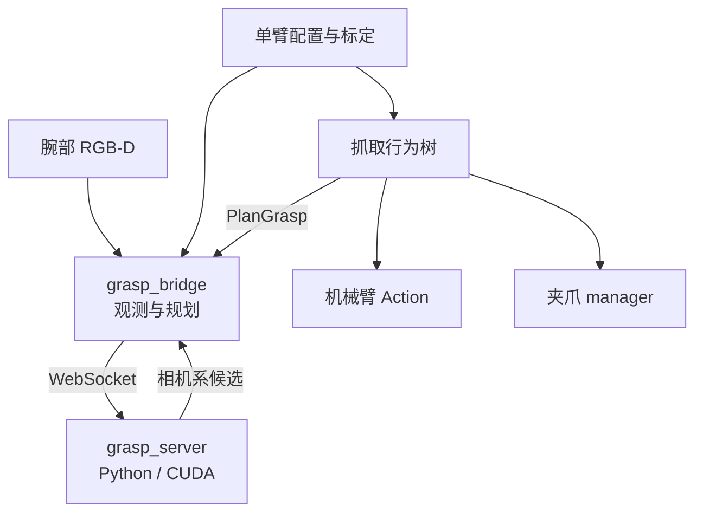
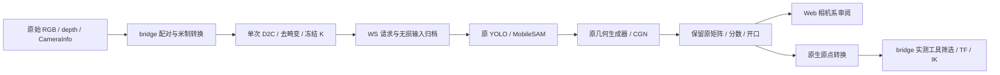

# 独立抓取算法与腕部规划桥

算法服务在独立 Docker 内运行，通过 WebSocket 接收 RGB-D 和目标类别，直接调用 `chaung_wei_2_jiao_fu` 的原始算法，返回相机坐标系中的抓取候选。容器不安装 ROS 2。机器人侧 `grasp_bridge` 采集观测、冻结坐标并筛选计划；行为树负责动作编排，机器人与夹爪驱动负责控制权和实际执行。

首版选右臂与右腕相机，场景限定静态桌面、停稳观测及经过验证的接近走廊。不需要 global 相机或多臂基座标定。左腕使用独立 profile、标定和几何，完成验收后复用同一算法服务。

::: warning 实测状态
仓库中的抓取配置尚未完成物理验收：手眼结果、真实 42D 开口和指爪、TCP 关系、观察位、返回位与工作区均需现场确认。空值和 `verified: false` 会阻止真实计划或执行。软件测试通过不代表机器人已经抓取成功。
:::

## 组件与源码



| 模块 | 源码 | 职责 |
| --- | --- | --- |
| 公共协议 | `src/grasp/grasp_protocol/` | 有界 MessagePack/NumPy、身份与矩阵校验 |
| 算法封装 | `src/grasp/grasp_server/` | 原始 InferenceWorker 的输入、输出、溯源与归档；不另写候选算法 |
| ROS 规划 | `src/grasp/grasp_bridge/` | 配对、D2C、拍照 TF、IK、诊断和可视化 |
| 任务编排 | `src/behavior/realman_bt/` | 任务控制权、抓取阶段、取消和故障处理 |
| 标定 | `src/sensor/realman_camera_calibration/` | 左右腕依次独立会话，不推导臂间布局 |

算法唯一来源是 `chaung_wei_2_jiao_fu/backend`：直接加载原始 `InferenceWorker`、YOLO、MobileSAM、物体专用几何生成器及 CGN wrapper。调用路径与该项目 `tools/offline_grasp/evaluate.py` 一致，使用原分辨率，不调用在线 `process()` 的 ROI/缩放路径。原项目的机器人状态机、ROS wrapper 和硬件控制不进入算法进程。



每次构建通过 named additional context 原样复制源文件。`models.yaml` 固定实际文件 SHA-256，涵盖原项目未提交的算法修正，不能只用 Git HEAD 代替。原项目的 `backend/config/` 和模型 `config.yaml` 是只读外部构建输入；本仓库只在根 `config/` 管理封装配置，不维护另一份算法实现或物体策略。

## 配置和换臂

| 权威文件 | 内容 |
| --- | --- |
| `config/ros/grasp_profiles.yaml` | 臂、相机、夹爪、工具引用、姿态和受限工作区 |
| `config/ros/camera_extrinsics.yaml` | 经过审批的单臂手眼身份、矩阵及独立验证误差 |
| `config/ros/grasp_task.yaml` | 目标与后端、租约、各阶段及人工确认超时 |
| `config/ros/grasp_bridge.yaml` | WS 地址、模型身份、时序、停稳和规划限制 |
| `config/grasp/gripper_specs.yaml` | 真实指爪和开口；兼容位置值不是毫米 |
| `config/grasp/models.yaml` | 模型与原始算法文件哈希、CGN 原生坐标约定 |
| `config/grasp/server.yaml` | 独立服务后端、原项目路径、种子、warmup、CGN context、归档和推理期限 |
| `config/docker/compose.grasp.yaml` | 算法容器；正常机器人启动不会拉起它 |

默认 profile 是 `right_wrist`；`left_wrist` 保留独立配置且未验收。选用哪个 profile，就使用它的相机、基座、法兰、IK namespace 和夹爪。TCP 只引用 `realman_coordinates.yaml` 的工具，不复制另一份偏移。更换相机安装或夹爪后重新确认相关身份和测量。

机器人侧 YAML 支持同目录 `*.local.yaml` 深合并，现场值无需覆盖版本控制内的空模板。模型和原始源码由算法 manifest 校验；物体策略直接使用原项目配置。请保持配置一致：腕相机串号必须与 `cameras_ros2.yaml` 相符，工具必须与控制器的默认工具相符。

## RGB-D、时间和坐标

`enable_frame_sync` 可以在相机 defaults 或单设备 parameters 设置，类型必须是 YAML 布尔值。共享默认关闭，两台腕相机显式开启，并同时开启原始深度。设备内同步、跨设备触发、D2C 空间配准是独立功能。

桥接默认订阅所选腕相机的原始 RGB、原始深度和各自 CameraInfo。它检查消息时间差、新鲜度、光学 frame、分辨率与标定内参哈希，依据实际光学外参进行 D2C 重投影，并用最近表面 z-buffer 处理遮挡。深度不会通过 resize 对齐。RGB 同时去畸变，发送的 K 与对齐深度属于同一针孔图像。`16UC1` 按毫米转换为米，`32FC1` 已是米；无效深度为零。

采集前需要连续、足够新鲜的关节反馈证明停稳；缺少 velocity 字段时由连续位置计算速度。机器人规划要求经过验证的近俯视观察方向。只读评估允许缺少手眼导出的向上向量，此时向原几何生成器传入 `None`，与原离线采集一致。

统一使用 `T_A_B` 将 B 中的点变换到 A：

```text
T_base_tcp = T_base_flange(t_capture) × T_flange_color
             × T_color_grasp × T_grasp_tcp
```

右腕 `right_wrist` 的控制器 TCP 已按抓取坐标系设置，`grasp_profiles.yaml` 中
`T_grasp_tcp` 使用 4×4 单位矩阵：TCP 与接触中心的原点及三根轴重合，规划不再额外叠加
平移或旋转，因此 `T_base_tcp = T_base_camera(t_capture) × T_camera_grasp`。
法兰到 TCP 的工具偏移仍由 `realman_coordinates.yaml` 管理。更换 TCP 定义后应重新核对
两坐标系是否仍重合；单位变换本身不代表 profile 的其他规划或执行条件已满足。

几何候选生成后，算法服务直接调用原项目 `grasp_selection.py` 的 `align_grasp_to_base_vertical`：使用采集时冻结的 `T_base_camera`，把接近轴强制对齐所选基座的 −Z，并保留接触中心。该函数连同原 worker 一起原样复制、校验源码哈希，不维护另一份对齐算法。与原在线服务一致，Contact-GraspNet 不执行这一步。

每个候选保留生成时的 `T_camera_native_grasp` 和对齐后的 `T_camera_native_grasp_aligned`；`T_camera_grasp_before_alignment` / `T_camera_grasp_after_alignment` 是各阶段转换到接触中心的矩阵。原点转换仅沿该阶段本地 Z 移动：几何使用原 worker 的 wrist offset，CGN 使用 manifest 固定的 native hand depth。`T_camera_grasp` 在对齐成功时采用对齐后结果，规划直接消费该矩阵；分数、宽度、目标归属和候选顺序不变。`vertical_alignment.status` 为 `applied`、`missing_base_camera` 或 `backend_not_applicable`。只读评估缺少基座变换时保留生成结果，对齐后字段为 null；几何真实规划缺少该变换会拒绝推理。CGN 的对齐后字段也为 null，页面明确标注沿用原始结果。

这些原点是算法坐标约定，不是机器人 TCP 标定。候选 X 是闭合方向，Z 是正向接近方向。预抓取沿负 Z 撤开；提起沿所选基座的正 Z。机器人姿态采用米与 `quaternion_wxyz`，算法不返回机器人 TCP。推理完成后不会重新取最新腕部 TF 替换拍照 TF；桥接只用当前姿态检查观测是否已经失效。

`/grasp.html` 在页面上方提供全宽的采集机械臂布局，自动取景覆盖所选臂、采集点云和候选，并突出显示所选对齐后接触中心。布局下方可切换候选，直接对照相机系与基座系的前后 XYZ（m）和 WXYZ，无需展开诊断 JSON。数值显示使用接触中心矩阵，算法线框仍使用原生矩阵；三臂世界布局仅参与展示。交互、不可用状态和只读边界见 [Web 评估页](./realman-web-control#grasp-离线评估页)。

## 单臂标定接入

先通过[单臂手眼标定](./camera-calibration)保存对应臂的求解结果，再显式导入：

```bash
PYTHONPATH=src/grasp/grasp_bridge python3 -m grasp_bridge.calibration_import \
  --config-root config --profile right_wrist \
  --result logs/camera_calibration/<session>/calibration_result.json
```

导入会核对会话、相机安装、臂、坐标与内容哈希，将矩阵写入忽略提交的 `camera_extrinsics.local.yaml`，保持 `verified: false`。完成留出样本和实际夹持区域精度验证后，再填写验证误差上限、实测误差及审批状态。求解器残差不自动变成抓取精度验收。

桥接直接使用经审阅的法兰到 color optical 矩阵，不额外发布相机安装 TF。设备内部 depth/color optical 关系仍由相机驱动发布；同一 frame 不得有两个 parent。

保存标定会话不等于抓取 profile 已加载外参。左右腕分别导入对应会话，导入器合并写入根配置下的 `config/ros/camera_extrinsics.local.yaml`，保留另一臂数据；每次评估重新加载 profile，无需重启机械臂驱动。已导入但尚未完成物理精度验收的结果可用于只读对齐，`verified: false` 不会阻断这一步，也不会因此允许真实规划。

采集时仅查询现有 `l/base_link ← l/link_6` 或 `r/base_link ← r/link_6`，以彩色图像时间戳计算 `T_base_camera = T_base_flange × T_flange_color`。标定结果里的 `tool_to_camera` 指的是不可变法兰 `link_6`，不能叠加控制器 TCP 偏移，也不使用 URDF 示意相机 frame 替代真实 color optical 外参。移动机械臂改变前一项；相机安装未变时，手眼外参不变。

评估快照的 `base_camera_transform` 记录基座、法兰、相机 frame、采集时间、标定 ID 和用于组合的两个矩阵。失败状态区分 `missing_calibration`、`invalid_calibration`、`calibration_identity_mismatch`、`tf_unavailable`；页面显示具体原因。采集时 TF 查询失败不会回退到最新 TF 或单位矩阵。

## 独立算法 Docker

从仓库根目录运行：

```bash
docker compose --project-directory . -f config/docker/compose.grasp.yaml config --quiet
# 默认原项目位于相邻目录；其他路径需同步修改 fs.read 授权范围。
GRASP_REFERENCE_REPO=../chaung_wei_2_jiao_fu \
  docker buildx bake --allow=fs.read=../chaung_wei_2_jiao_fu \
  --allow=network.host -f config/docker/compose.grasp.yaml
# 默认权重来自相邻原项目 backend/models；运行时不再挂载算法源码。
docker compose --project-directory . -f config/docker/compose.grasp.yaml up -d --no-deps --force-recreate grasp_server
```

构建显式允许 host 网络以访问构建机代理，运行时仍使用独立容器网络与仅绑定 loopback 的端口。镜像固定 Python/Torch/CUDA 与模型依赖，权重只读挂载；不映射串口、USB，也不需要 ROS 图。首次使用前在模型 manifest 固定实际文件哈希，确认目标 GPU 驱动支持镜像 CUDA。缺少权重、类别身份或依赖时相应后端不可用，不会自动下载 COCO 替代模型。

构建新镜像后需要重建算法容器；`docker compose restart` 仍使用原容器的旧镜像。只读评估出现 `received 1003 ... up_camera must be an explicit unit vector` 时，先核对实际容器镜像与本地镜像是否一致：

```bash
docker inspect realman-grasp-grasp_server-1 --format '{{.Image}}'
docker image inspect realman-grasp-server:local --format '{{.Id}}'
docker compose --project-directory . -f config/docker/compose.grasp.yaml logs --tail 30 grasp_server
```

正常服务的 hello 应与当前镜像一致，并加载配置中的 geometry 和 contact_graspnet 后端。只读且没有基座标定时，`up_camera=None` 合法，不应补造相机轴来绕过旧服务校验。被拒绝的请求没有推理结果，不能按“算法生成了零候选”比较数量。数量对照应先把同一归档的 RGB、深度、K 和参数送入两条路径，再比较；实时图像、设备配准或观察位置变化均可能影响结果。

实例在原 worker 深度范围内的有效点数小于其 `min_segment_points` 时，适配层跳过该实例，其余实例继续调用原几何/CGN 算法；深度范围、点数阈值与原算法源码不变。这是与原离线 `evaluate.py` 整帧拒绝策略的明确差异。几何调用前只选择有效检测，临时映射连续实例 ID，返回后恢复原 ID；避免原 worker 对被跳过实例执行 bbox 回退。跳过的 mask 仍参与原算法的其他物体遮挡判断，归档与可视化保留原检测和分割标签。

`diagnostics.skipped_instances` 记录原实例 ID、有效点数、最低点数和 `insufficient_valid_depth` 原因；页面显示跳过清单。所有目标实例都不足时返回正常空候选，原因为 `no_valid_instances`，不调用生成器。未检测到目标为 `no_target`。整幅场景有效点云不足仍报告推理失败；部分实例的深度不足不会再触发 `Instances have insufficient valid depth points` 整帧拒绝。

默认同时加载原几何和 Contact-GraspNet 后端。封装不增加指爪邻域碰撞筛选、工具开口筛选或重新评分，按原算法顺序保留 top-k；原几何分数可能大于 1，不应解释为概率。CGN 的 `cgn_context` 支持 `mask`、`box`、`full`，分别控制原 wrapper 的局部区域与相机包围盒参数；三者都保持原离线工具的目标归属过滤。

每个已接收的推理写入 `logs/grasp-server/<archive_id>/`：`request.msgpack` 保存完整身份与参数，`frame.npz` 无损保存 BGR、米制深度、K 和可用的向上向量，`result.msgpack` 保存原矩阵、分数、开口、无损实例分割 PNG、来源哈希与结果。失败写入 `error.msgpack`。归档失败会拒绝结果，服务不会静默清理历史，需由宿主机管理保留周期。取消或超时后仍在运行的计算可以完成归档，但不会再次发布为可执行结果。

## WebSocket 契约

服务先发送 `hello`，包含协议版本、就绪状态、后端及模型身份。请求是二进制 MessagePack，数值数组有 dtype、shape 和字节长度限制，不使用 pickle。

输入包含 task/request/observation ID、generation、拍照时间戳、config ID、color optical frame、BGR `uint8[H,W,3]`、已配准米制深度 `float32[H,W]`、K、可选相机系向上单位向量、采集时 `T_base_camera`、目标类别、CGN context 与夹爪身份。基座变换必须为刚性齐次矩阵；同时提供向上向量时须与变换导出的基座 +Z 一致。输出逐项保留身份，并包含模型和夹爪身份、前后候选矩阵及对齐状态、估计开口、目标归属与后端评分。`frame.npz` 和完整请求归档保留该冻结变换，replay 自动读取它；旧离线文件没有该字段时仅显示原始结果。

机器人规划的 `expected_model_id` 必须固定为已核验服务身份。显式 `evaluation_only=true` 允许未固定模型身份，仍核对 hello 与结果的身份一致性；若配置了固定身份，评估也必须匹配。一次任务只有一个在途请求；超时、取消、断线和 generation/profile 变化使旧结果失效。重新连接不重放观测。GPU 计算可能继续，但失效结果不会恢复为可执行计划。

## ROS 规划与无运动验证

先构建接口和桥接包，在仓库根目录执行：

```bash
source /opt/ros/humble/setup.bash
python3 -m pip install -r config/python/policy-bridge-requirements.txt
colcon build --packages-up-to grasp_bridge
source install/setup.bash
ros2 launch grasp_bridge grasp_bridge.launch.py config_root:="$PWD/config"
```

宿主机构建须先安装上面的共享传输依赖；Ubuntu 22.04 自带的 websockets 版本不足以提供同步客户端。ROS Docker 已安装这些依赖。

默认配置 `dry_run=true` 时创建 RGB-D、关节和 TF 的只读订阅，允许 Web grasp 评估页采集观测；不创建 IK 或任务状态 client，因此不会生成 waypoint。未批准的手眼标定会阻止基座系 pose 计算，但相机系图像和深度仍可审阅。只读评估不要求已测量的夹爪尺寸或手眼：只发送夹爪身份，保留原始相机系候选。真实规划才要求实测工具，并在 bridge 规划阶段根据开口筛选，原始候选列表不被改写。普通规划请求仍会被 dry-run 拒绝。携带任务 lease 的请求在采集、推理前后及输出计划前使用只读 `TaskControl STATUS` 核对有效期；撤销或过期会使计划失效。独立只读评估不携带 lease。真实观测与 IK 规划需要显式设置 `dry_run:=false`，完成几何/标定/走廊输入并固定模型身份；该入口仍不发送机械臂或夹爪命令。

| 接口 | 类型/意义 |
| --- | --- |
| `/grasp_bridge/plan_grasp` | `realman_msgs/action/PlanGrasp`，可取消、规划专用 |
| `/grasp_bridge/diagnostics` | `diagnostic_msgs/DiagnosticArray`，阶段与拒绝原因 |
| `/grasp_bridge/plan` | `std_msgs/String`，选定计划和拒绝记录 JSON |
| `/grasp_bridge/candidates` | `geometry_msgs/PoseArray`，color optical 候选 |
| `/grasp_bridge/overlay` | `sensor_msgs/Image`，去畸变 RGB 上的候选中心 |
| `/<arm>/solve_ik` | 既有 IK Service；使用当前关节 seed 和默认工具 |

规划会逐段采样预抓取—抓取—提起的直线走廊，拒绝工作区越界、IK 失败或过大的关节分支变化。它不提供全场景整臂碰撞规划：到达预抓取位和返回位的整臂路径必须预先验证，其他机械臂必须停放。

### 从候选审阅到首次抓取

建议先完成右腕、几何后端、单个静止物体的完整闭环，再扩展多目标与 CGN。页面中的人工“接受”是离线标注，不会锁定后续任务的目标，也不会授权执行；现有 `choose_plan()` 按算法顺序选择首个通过开口、工作区和逐段 IK 校验的候选。真实任务在观察位停稳后重新采集，不复用浏览器中的旧快照。

1. **确定接触中心到 TCP 的实测关系。** 核对 `gripper_specs.yaml` 的真实开口、指深、厚度与间隙，以及 `grasp_profiles.yaml` 的 `T_grasp_tcp`。规划使用 `T_base_camera(t_capture) × T_camera_grasp_after_alignment × T_grasp_tcp`；仅在 TCP 与接触中心的原点和轴向重合、该变换为单位矩阵时，对齐后的基座系接触中心位姿才等于 TCP 目标。手眼的留出验证误差还需满足 `camera_extrinsics.yaml` 中的验收要求。
2. **先验证计划。** 补齐 profile 的观察位、返回位、工作区、接近与提起距离，并实测完整走廊。确认配置与服务模型身份后，用规划桥只输出 `pregrasp/grasp/lift`，核查基座坐标、TCP 朝向和 IK 连续性。现有规划不检查全场景的夹指、腕部和整臂碰撞；对齐轴正确、分数高或 IK 有解均不能替代这项验证。
3. **分阶段执行既有行为树。** `config/behavior-trees/grasp.xml` 已编排张爪、观察、规划、预抓取、下降、闭爪、提起、保持、人工确认、返回和释放。预抓取沿候选负 Z 撤开，几何竖直对齐后即基座正 Z；下降沿接近方向，提起沿基座正 Z。全流程使用同一任务 lease，移动后观测失效则重新采集；执行前完成 dry-run，再由操作员决定真实运动。
4. **分别记录命令与物理结果。** 首次验收关注夹指是否真正围住物体、提起后是否稳定，以及释放后的状态。42D 的闭合反馈不能证明抓稳；确认失败时保留现场状态，按人工决定处置，不能自动重跑会先张爪的完整树。

`/grasp.html` 另提供受限的手动基座系 MOVEL 测试入口：选择在线 observation 中的候选会填入其基座系接触中心 XYZ/WXYZ，点击发送后复用 `/<arm>/execute_motion`。仅当驱动坐标状态确认 `motion_allowed=true`、机械臂在线且当前 TCP 与快照工具一致时放行；离线导入不能运动。对右臂而言，只有 `T_grasp_tcp` 为单位矩阵时接触中心 Pose 才能直接作为 TCP 目标。这个测试入口不是抓取任务执行器，不会调用 IK 连续性或碰撞走廊校验，也不会自动闭爪或提起；仍需先独立验证目标和全程安全性。

## 结果与限制

42D 只有全开、全闭；候选宽度只用于筛选。命令完成、兼容位置、电流或 `torque_reached` 不能证明物体已抓稳。提起后保持并通过视频或人工确认；`GraspConfirm` 仅在等待期间提供 `/realman_bt_executor/confirm_grasp`，要求当前 task ID、明确的观察结果及放回决定。批准后沿已验证的载物返回路径到释放位，再张开夹爪；拒绝、超时或取消不会自动放回或松开。配置和请求示例见[抓取行为树](./behavior-tree-motion)。

[抓取行为树](./behavior-tree-motion)通过任务控制权覆盖观察、推理、机械臂和夹爪阶段。驱动拒绝不持有任务 token 的竞争写命令，租约失效也不能跳过未确认停止的硬件工作。算法、规划、执行和抓取结果分别记录，避免将“候选非空”计为抓取成功。

离线验证入口：

```bash
PYTHONPATH=src/grasp:src/grasp/grasp_bridge \
  python3 -m pytest src/grasp/grasp_bridge/test tests/test_host_cameras.py -q
```

测试覆盖真实投影基线与遮挡、时间差/新鲜度、TCP 变换、受限走廊及 IK 多候选拒绝。使用原项目已安装模型依赖的 Python，运行完整 WS 回放对照：

```bash
GRASP_REFERENCE_BACKEND=/path/to/chaung_wei_2_jiao_fu/backend \
GRASP_PARITY_RUN=/path/to/chaung_wei_2_jiao_fu/results/offline_grasp/runs/20261021_130236 \
PYTHONPATH=src/grasp PYTEST_DISABLE_PLUGIN_AUTOLOAD=1 \
/path/to/chaung_wei_2_jiao_fu/.venv/bin/python -m pytest \
  src/grasp/tests/test_reference_parity.py -q -s
```

对已启动的隔离测试容器，设置 `GRASP_PARITY_URI=ws://127.0.0.1:18091`，测试会使用实际镜像服务，无需宿主机加载模型。归档中的检测、分割、原始矩阵、宽度和分数均需匹配，矩阵与数值容差为 `1e-6`。

| 归档相机 | 几何 | CGN mask | CGN box |
| --- | --- | --- | --- |
| 右腕 `CV2856D0002E` | 15 | 0 | 9 |
| 左腕 `CV2856D0008H` | 15 | 15 | 15 |

这只证明相同冻结输入的算法与传输一致。实时 SDK D2C 与 bridge 软件 D2C 的像素差异、真实曝光/深度档位、物理精度和实际抓取须分别现场验收；不能将候选非空视为抓取成功。
