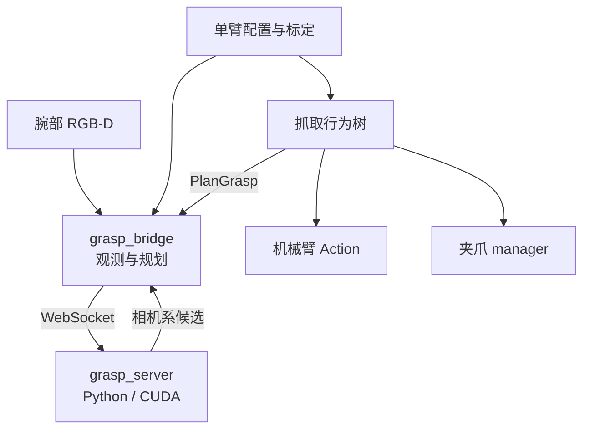

# 独立抓取算法与腕部规划桥

算法服务在独立 Docker 内运行，通过 WebSocket 接收 RGB-D、目标类别和夹爪几何，返回相机坐标系中的抓取候选。容器不安装 ROS 2。机器人侧 `grasp_bridge` 采集观测、冻结坐标并筛选计划；行为树负责动作编排，机器人与夹爪驱动负责控制权和实际执行。

首版选右臂与右腕相机，场景限定静态桌面、停稳观测及经过验证的接近走廊。不需要 global 相机或多臂基座标定。左腕使用独立 profile、标定和几何，完成验收后复用同一算法服务。

::: warning 实测状态
仓库中的抓取配置尚未完成物理验收：手眼结果、真实 42D 开口和指爪、TCP 关系、观察位、返回位与工作区均需现场确认。空值和 `verified: false` 会阻止真实计划或执行。软件测试通过不代表机器人已经抓取成功。
:::

## 组件与源码



| 模块 | 源码 | 职责 |
| --- | --- | --- |
| 公共协议 | `src/grasp/grasp_protocol/` | 有界 MessagePack/NumPy、身份与矩阵校验 |
| 算法 | `src/grasp/grasp_server/` | YOLO、MobileSAM、支撑面几何、可选 CGN adapter |
| ROS 规划 | `src/grasp/grasp_bridge/` | 配对、D2C、拍照 TF、IK、诊断和可视化 |
| 任务编排 | `src/behavior/realman_bt/` | 任务控制权、抓取阶段、取消和故障处理 |
| 标定 | `src/sensor/realman_camera_calibration/` | 左右腕依次独立会话，不推导臂间布局 |

参考来源是 `chaung_wei_2_jiao_fu` 的检测、分割与候选生成流程。旧服务的机器人状态机、ROS wrapper、固定腕部补偿与硬件控制没有整体移入新算法进程。

## 配置和换臂

| 权威文件 | 内容 |
| --- | --- |
| `config/ros/grasp_profiles.yaml` | 臂、相机、夹爪、工具引用、姿态和受限工作区 |
| `config/ros/camera_extrinsics.yaml` | 经过审批的单臂手眼身份、矩阵及独立验证误差 |
| `config/ros/grasp_task.yaml` | 目标与后端、租约、各阶段及人工确认超时 |
| `config/ros/grasp_bridge.yaml` | WS 地址、模型身份、时序、停稳和规划限制 |
| `config/grasp/gripper_specs.yaml` | 真实指爪和开口；兼容位置值不是毫米 |
| `config/grasp/object_policies.yaml` | 自定义目标类别与几何策略 |
| `config/grasp/models.yaml` | 模型文件、版本、哈希、CGN 原生坐标约定 |
| `config/grasp/server.yaml` | 独立服务后端、设备和推理期限 |
| `config/docker/compose.grasp.yaml` | 算法容器；正常机器人启动不会拉起它 |

默认 profile 是 `right_wrist`；`left_wrist` 保留独立配置且未验收。选用哪个 profile，就使用它的相机、基座、法兰、IK namespace 和夹爪。TCP 只引用 `realman_coordinates.yaml` 的工具，不复制另一份偏移。更换相机安装或夹爪后重新确认相关身份和测量。

机器人侧 YAML 支持同目录 `*.local.yaml` 深合并，现场值无需覆盖版本控制内的空模板。模型与物体策略由算法服务的显式配置管理。请保持配置一致：腕相机串号必须与 `cameras_ros2.yaml` 相符，工具必须与控制器的默认工具相符。

## RGB-D、时间和坐标

`enable_frame_sync` 可以在相机 defaults 或单设备 parameters 设置，类型必须是 YAML 布尔值。默认仍为关闭；确认 Gemini 305 能力后再开启。设备内同步、跨设备触发、D2C 空间配准是独立功能。

桥接默认订阅所选腕相机的原始 RGB、原始深度和各自 CameraInfo。它检查消息时间差、新鲜度、光学 frame、分辨率与标定内参哈希，依据实际光学外参进行 D2C 重投影，并用最近表面 z-buffer 处理遮挡。深度不会通过 resize 对齐。RGB 同时去畸变，发送的 K 与对齐深度属于同一针孔图像。`16UC1` 按毫米转换为米，`32FC1` 已是米；无效深度为零。

采集前需要连续、足够新鲜的关节反馈证明停稳；缺少 velocity 字段时由连续位置计算速度。首版要求经过验证的近俯视观察方向。

统一使用 `T_A_B` 将 B 中的点变换到 A：

```text
T_base_tcp = T_base_flange(t_capture) × T_flange_color
             × T_color_grasp × T_grasp_tcp
```

候选原点是夹持中心，X 是闭合方向，Z 是正向接近方向。预抓取沿负 Z 撤开；提起沿所选基座的正 Z。机器人姿态采用米与 `quaternion_wxyz`，算法不返回机器人 TCP。推理完成后不会重新取最新腕部 TF 替换拍照 TF；桥接只用当前姿态检查观测是否已经失效。

## 单臂标定接入

先通过[单臂手眼标定](./camera-calibration)保存对应臂的求解结果，再显式导入：

```bash
PYTHONPATH=src/grasp/grasp_bridge python3 -m grasp_bridge.calibration_import \
  --config-root config --profile right_wrist \
  --result logs/camera_calibration/<session>/calibration_result.json
```

导入会核对会话、相机安装、臂、坐标与内容哈希，将矩阵写入忽略提交的 `camera_extrinsics.local.yaml`，保持 `verified: false`。完成留出样本和实际夹持区域精度验证后，再填写验证误差上限、实测误差及审批状态。求解器残差不自动变成抓取精度验收。

桥接直接使用经审阅的法兰到 color optical 矩阵，不额外发布相机安装 TF。设备内部 depth/color optical 关系仍由相机驱动发布；同一 frame 不得有两个 parent。

## 独立算法 Docker

从仓库根目录运行：

```bash
docker compose --project-directory . -f config/docker/compose.grasp.yaml config --quiet
docker buildx bake --allow=network.host -f config/docker/compose.grasp.yaml
GRASP_MODELS_DIR=/path/to/verified/models \
  docker compose --project-directory . -f config/docker/compose.grasp.yaml up grasp_server
```

构建显式允许 host 网络以访问构建机代理，运行时仍使用独立容器网络与仅绑定 loopback 的端口。镜像固定 Python/Torch/CUDA 与模型依赖，权重只读挂载；不映射串口、USB，也不需要 ROS 图。首次使用前在模型 manifest 固定实际文件哈希，确认目标 GPU 驱动支持镜像 CUDA。缺少权重、类别身份或依赖时相应后端不可用，不会自动下载 COCO 替代模型。

默认几何后端执行 YOLO → MobileSAM → 受限的三维顶面/PCA 候选启发式及可见邻域指爪筛选。它尚未覆盖参考项目所有物体专用策略，也不提供完整场景碰撞检测。Contact-GraspNet 是显式可选后端，需额外安装匹配运行库和经核对的模型；只接受属于所选目标分割区域的候选。两种分数不作跨后端概率比较。CGN 原生 hand depth 只由其 adapter 处理，不能代替本机实测 TCP。

## WebSocket 契约

服务先发送 `hello`，包含协议版本、就绪状态、后端及模型身份。请求是二进制 MessagePack，数值数组有 dtype、shape 和字节长度限制，不使用 pickle。

输入包含 task/request/observation ID、generation、拍照时间戳、config ID、color optical frame、BGR `uint8[H,W,3]`、已配准米制深度 `float32[H,W]`、K、相机系向上单位向量、目标类别与夹爪几何。输出逐项保留身份，并包含模型和夹爪身份、候选矩阵、估计开口、目标归属与后端评分。

桥接的 `expected_model_id` 必须固定为已核验服务身份。一次任务只有一个在途请求；超时、取消、断线和 generation/profile 变化使旧结果失效。重新连接不重放观测。GPU 计算可能继续，但失效结果不会恢复为可执行计划。

## ROS 规划与无运动验证

先构建接口和桥接包，在仓库根目录执行：

```bash
source /opt/ros/humble/setup.bash
python3 -m pip install -r config/python/policy-bridge-requirements.txt
colcon build --packages-up-to grasp_bridge
source install/setup.bash
ros2 launch grasp_bridge grasp_bridge.launch.py config_root:="$PWD/config"
```

宿主机构建须先安装上面的共享传输依赖；Ubuntu 22.04 自带的 websockets 版本不足以提供同步客户端。ROS Docker 已安装这些依赖。

默认配置 `dry_run=true` 时创建 RGB-D、关节和 TF 的只读订阅，允许 Web grasp 评估页采集观测；不创建 IK 或任务状态 client，因此不会生成 waypoint。未批准的手眼标定会阻止基座系 pose 计算，但相机系图像和深度仍可审阅。两个 policy backend 都要求有效夹爪开口/指爪几何来过滤候选；这些尺寸缺失或未测量时，快照会保留图像并显示 inference 拒绝原因，不会填入虚构默认值。普通规划请求仍会被 dry-run 拒绝。携带任务 lease 的请求在采集、推理前后及输出计划前使用只读 `TaskControl STATUS` 核对有效期；撤销或过期会使计划失效。独立只读评估不携带 lease。真实观测与 IK 规划需要显式设置 `dry_run:=false`，完成几何/标定/走廊输入并固定模型身份；该入口仍不发送机械臂或夹爪命令。

| 接口 | 类型/意义 |
| --- | --- |
| `/grasp_bridge/plan_grasp` | `realman_msgs/action/PlanGrasp`，可取消、规划专用 |
| `/grasp_bridge/diagnostics` | `diagnostic_msgs/DiagnosticArray`，阶段与拒绝原因 |
| `/grasp_bridge/plan` | `std_msgs/String`，选定计划和拒绝记录 JSON |
| `/grasp_bridge/candidates` | `geometry_msgs/PoseArray`，color optical 候选 |
| `/grasp_bridge/overlay` | `sensor_msgs/Image`，去畸变 RGB 上的候选中心 |
| `/<arm>/solve_ik` | 既有 IK Service；使用当前关节 seed 和默认工具 |

规划会逐段采样预抓取—抓取—提起的直线走廊，拒绝工作区越界、IK 失败或过大的关节分支变化。它不提供全场景整臂碰撞规划：到达预抓取位和返回位的整臂路径必须预先验证，其他机械臂必须停放。

## 结果与限制

42D 只有全开、全闭；候选宽度只用于筛选。命令完成、兼容位置、电流或 `torque_reached` 不能证明物体已抓稳。提起后保持并通过视频或人工确认；`GraspConfirm` 仅在等待期间提供 `/realman_bt_executor/confirm_grasp`，要求当前 task ID、明确的观察结果及放回决定。批准后沿已验证的载物返回路径到释放位，再张开夹爪；拒绝、超时或取消不会自动放回或松开。配置和请求示例见[抓取行为树](./behavior-tree-motion)。

[抓取行为树](./behavior-tree-motion)通过任务控制权覆盖观察、推理、机械臂和夹爪阶段。驱动拒绝不持有任务 token 的竞争写命令，租约失效也不能跳过未确认停止的硬件工作。算法、规划、执行和抓取结果分别记录，避免将“候选非空”计为抓取成功。

离线验证入口：

```bash
PYTHONPATH=src/grasp:src/grasp/grasp_bridge \
  python3 -m pytest src/grasp/grasp_bridge/test tests/test_host_cameras.py -q
```

测试覆盖真实投影基线与遮挡、时间差/新鲜度、TCP 变换、受限走廊及 IK 多候选拒绝。带模型回放、GPU 镜像运行、物理精度和实际抓取应分别记录验收结果。
