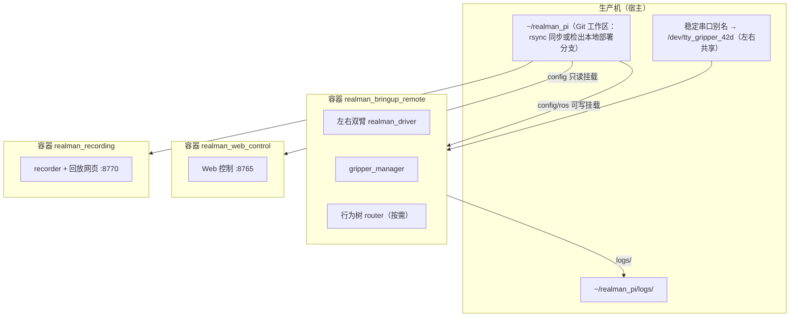

# 生产运维手册

本页是**现场记录**，面向要登录生产机查问题、更新代码或做小范围重启的开发者。它不是产品契约：命令和数值来自实际操作，带日期的条目只代表当时的状态，用之前请先核对。页面里不放主机名、内网地址、账号或密钥；这些属于你自己的 SSH 配置。

::: warning 生产机上有真实机械臂在运行
本页的部署、"只重启一个组件"和"清理日志"都会影响运行中的系统。先确认机械臂静止、急停可达；能整套重启时优先用 `./rm65 down` / `./rm65 up`（见[CLI 与环境变量](../reference/cli-and-env)）。
:::

## 生产机布局



- **ROS 栈只在容器里**：`/opt/rm65_ws`（安装空间、源码副本、`config/ros/*.yaml`）只存在于容器内部。宿主上 `ps` 能看到这些进程（以 root 运行），但路径在宿主上不存在。读配置和日志用 `docker exec` / `docker logs`。
- **容器名**：`realman_pi-realman_bringup_remote-1`（驱动、夹爪、相机、router）、`realman_pi-realman_web_control-1`（`:8765`）和 `realman_pi-realman_recording-1`（数据录制与回放网页 `:8770`，`./rm65 up` 会一并启动，见[独立数据录制平台](./recording-platform)）。取决于部署，还可能有策略桥；以 `docker ps` 为准。
- **配置是宿主文件**：`config/ros` 以可写方式挂进 `realman_bringup_remote`，`config` 以只读方式挂进 `realman_web_control`。所以改**宿主**上的 YAML，重启对应进程即可生效，不用重建镜像。
- **当前硬件只有左右双臂和两只 42D**：`realman_driver.yaml` 只保留 `/l/realman_driver`、`/r/realman_driver`，多臂 launch 跳过不存在的中臂 section。`recording.yaml` 同样只订阅、预检左右双臂与两夹爪；`three_robots.yaml` 中的中臂仅是通用模型与标定参考，不要求其中臂连接或话题在线。
- **ROS domain** 是 `65`（来自 `.env`）。

## 常用查询

在容器里使用 ROS CLI 必须先 source 环境，否则看到的是一张空图：

```bash
docker exec realman_pi-realman_bringup_remote-1 bash -c '
  source /opt/ros/humble/setup.bash
  source /opt/rm65_ws/install/setup.bash
  ros2 topic echo --once /gripper_left/alarm'
docker logs --tail 100 realman_pi-realman_bringup_remote-1
docker exec realman_pi-realman_bringup_remote-1 cat /opt/rm65_ws/config/ros/gripper.yaml
```

日志目录是宿主的 `~/realman_pi/logs/` = 容器的 `/opt/rm65_ws/logs/`，每次 launch 一个 `YYYYMMDD_HHMMSS` 目录，**名字用 UTC 时间**，与宿主本地时间差一个时区。

## 更新代码（部署）

生产机**不能直接从 GitHub 拉代码**（`git fetch origin` 会一直挂住，宿主上的 `origin/*` 因此是旧的），代码只能从开发机送过去。有两种方式：

| 方式 | 适合 | 生产机上的结果 |
| --- | --- | --- |
| `./rm65 sync`（rsync） | 发布已合并的 `main` | 已跟踪文件被覆盖，分支不变 |
| git bundle → 本地部署分支 | 部署还没合并的分支（例如待合并的 PR），或需要能一条命令切回原来的提交 | 宿主检出一个本地分支，例如 `deploy/main-<日期>` |

两种方式都只更新**宿主文件**。配置类改动（YAML）重启对应进程就生效；**代码类改动要重建镜像**才会进容器，因为容器里的 `src/` 是镜像构建时拷贝的副本。

### 方式一：`./rm65 sync`

`./rm65 sync` 会校验当前在 `main` 且工作区干净，推送后再 rsync；它只同步已跟踪文件，且不带 `--delete`。

同步前先搞清楚会覆盖什么：

1. **生产机的工作区通常是"脏"的**：现场调参会直接改宿主上的 `config/ros/*.yaml`（如 `gripper.yaml`、`pika_config.yaml`、`realman_driver.yaml`）。rsync 会用开发机的版本覆盖它们。
2. 先做一次 dry-run，看哪些文件会变：

   ```bash
   git ls-files -z | rsync -azn --from0 --files-from=- --relative \
     --itemize-changes --checksum ./ <生产机>:~/realman_pi/
   ```

   如果列表里出现了你没改过的配置文件，说明生产机上有未回灌到仓库的现场修改，**先把它们合回仓库**再同步。

### 方式二：git bundle 部署一个分支

下面的命令里，`<分支>` 是要部署的分支，`<日期>` 用来给备份、镜像标签和部署分支命名。

<Steps>

1. **在生产机上备份**。记下当前提交、未提交的现场改动和当前镜像，再给镜像打一个回滚标签：

   ```bash
   cd ~/realman_pi
   B=~/deploy-backups/redeploy-$(date +%Y%m%d-%H%M%S); mkdir -p "$B/config/ros"
   cp -p .env "$B/"
   cp -p config/ros/<现场改过的 yaml> "$B/config/ros/"
   git diff > "$B/tracked-changes.patch"
   { git rev-parse HEAD; git branch --show-current; } > "$B/head.txt"
   docker image inspect rm65-humble-rviz:local -f '{{.Id}}' > "$B/image.txt"
   docker tag rm65-humble-rviz:local rm65-humble-rviz:pre-<日期>
   ```

2. **在开发机上打包，拷到生产机**。`^<基准>` 是生产机上已有的某个提交，加上它 bundle 只带增量；不确定就去掉，打包整个分支：

   ```bash
   git bundle create deploy.bundle <分支> ^<基准>
   git bundle verify deploy.bundle
   scp deploy.bundle <生产机>:/tmp/
   ```

3. **在生产机上检出部署分支**：

   ```bash
   git fetch /tmp/deploy.bundle <分支>:refs/remotes/bundle/<分支>
   git checkout -- <有现场改动的已跟踪文件>
   git checkout -B deploy/<分支>-<日期> refs/remotes/bundle/<分支>
   ```

   - 有现场改动的已跟踪文件会挡住检出，所以先还原它们（改动已经在第 1 步的 patch 和备份里）。
   - 未跟踪的配置文件如果和新分支里的同名文件冲突，也会挡住检出，先挪进备份目录。
   - 检出后，对照 `"$B/tracked-changes.patch"`，把仍需要的现场改动（例如 `.env` 里的策略主机、调过的限速）逐项改回去。不要整份 `git apply`：新分支可能已经改过同一处。

4. **重建镜像并启动**。宿主环境里设了代理变量时，构建要去掉它们：

   ```bash
   env -u HTTP_PROXY -u HTTPS_PROXY -u ALL_PROXY \
     -u http_proxy -u https_proxy -u all_proxy ./rm65 build
   ./rm65 up policy        # 不需要策略桥时用 ./rm65 up
   ```

   `./rm65 up` 会用新镜像重新创建 bringup、web、recording（以及 `policy_bridge`）容器。live 行为树（`scripts/bt.sh control`）不在这些容器里，**不会**跟着重启：`up` 之前先停掉它，之后再按[行为树控制](./behavior-tree-control)重新启动，并把输入模式选回 `none`。

</Steps>

### 部署后核对

逐项读回实际值，不要只看容器状态是不是 `Up`：

- 用 `ros2 topic hz` 核对 `/{l,r}/joint_states` 和相机输出频率；左右夹爪的轮询取自 `config/ros/gripper.yaml` 的 `poll_hz: 5.0`，实际受共享总线事务耗时限制。中臂未安装，不应有其驱动重连，也不要求中臂或中夹爪话题。
- `:8765` 和 `:8770` 返回 200；`:8765` 页面引用的每个 `/assets/*` 也返回 200。
- 用 `ros2 param dump` / `ros2 param get` 读回关键参数，例如 router 的限速和 `dry_run`、执行器的 `policy_task.task_names`。
- 要跑策略时：`/policy/stats` 有输出，而且带 `prompt` 字段（见[行为树里的 policy 任务](./policy-task)）。

### 回滚

1. 回到部署前的提交并恢复现场改动：`git checkout -f <head.txt 里的分支>`，再 `git apply "$B/tracked-changes.patch"`，然后把备份的 `.env` 和 YAML 拷回原处。
2. 恢复镜像：`docker tag rm65-humble-rviz:pre-<日期> rm65-humble-rviz:local`。
3. `./rm65 up`（或 `./rm65 up policy`），然后重新启动 live 行为树。

## 只更新 `:8765` 网页

两种情况都不影响驱动和机器人运行。

### 只改了前端：替换静态文件

`:8765` 的前端是 Vite 生成的静态文件，位于 `src/driver/realman_web_control/realman_web_control/static/`，由 `npm run build:web-control` 生成并提交进仓库。只改了前端时，可以直接替换运行中容器里的这批文件，不用重建镜像，也不用重启进程。

在生产机上备份当前网页：

```bash
C=realman_pi-realman_web_control-1
P=/opt/rm65_ws/src/driver/realman_web_control/realman_web_control
docker exec $C tar -C $P -cf - static > ~/deploy-backups/web-static-$(date +%Y%m%d-%H%M%S).tar
```

在开发机的 `src/driver/realman_web_control/realman_web_control/` 目录里，把整个 `static/` 送进容器：

```bash
COPYFILE_DISABLE=1 tar --no-xattrs -cf - static | ssh <生产机> \
  'docker exec -i realman_pi-realman_web_control-1 tar -xf - --no-same-owner \
     -C /opt/rm65_ws/src/driver/realman_web_control/realman_web_control'
```

容器里的安装空间是用 `--symlink-install` 建的，`install/.../static/assets/` 里每个文件都是单独的符号链接。新生成的文件名带新的哈希，在那里还没有链接，所以要补上。在生产机上：

```bash
docker exec realman_pi-realman_web_control-1 bash -c '
  I=/opt/rm65_ws/install/realman_web_control/share/realman_web_control/static/assets
  B=/opt/rm65_ws/build/realman_web_control/realman_web_control/static/assets
  for f in $(ls $B); do [ -e $I/$f ] || ln -sfn $B/$f $I/$f; done'
```

最后用 `curl` 确认 `/` 和 `/calibration.html` 引用的每个 `/assets/*` 都返回 200。回滚就是把备份的 tar 用同样方法解回去。

替换后的文件只在**当前容器**里有效，容器一旦重建，就回到镜像里的版本。所以这只是临时上线，改动仍要合并，再按上面的方式正式部署。

### 改了 Python：只重建 web 容器

```bash
OLD=$(docker image inspect rm65-humble-rviz:local --format '{{.Id}}')
docker tag "$OLD" rm65-humble-rviz:pre-<日期>          # 回滚点
docker compose build realman_web_control               # 首次较慢（会跑 colcon 测试）
docker compose up -d --no-deps realman_web_control     # 只重建这一个容器
curl -s http://127.0.0.1:8765/api/layout | head -c 200
```

注意镜像标签 `rm65-humble-rviz:local` 是几个服务共用的：重建后，**正在运行的驱动容器仍用旧镜像**，但它下次被重启（人工、Docker 或主机重启）时会换成新镜像，把新镜像里的全部改动一并带上。回滚：把备份标签改回 `rm65-humble-rviz:local` 再重建对应容器。

::: danger 容器里的 src 可能落后于仓库
容器内的源码是上次重建镜像时的副本，可能比仓库 `HEAD` 旧（例如还没有新的 IK 接口）。**不要用 `docker cp` 把仓库里的整个源文件覆盖进去**，只补丁你要改的那一段，并先把原文件备份到宿主（如 `~/deploy-backups/`）。上面替换 `static/` 是例外：那是一整套生成文件，必须整体替换。
:::

## 只重启一个组件（不整套重启）

驱动容器里，当前 `{l,r}_realman_driver` 是 PID 1（`ros2 launch`）的子进程，launch **不会自动拉起**它们，各进程互不影响。需要只重启一台已安装臂的驱动或只重启夹爪 manager 时：

<Steps>

1. 取该进程的环境：`cat /proc/<兄弟进程 pid>/environ`（用同类进程的环境）。
2. 发 `SIGINT` 让它干净退出（约 1 秒）：`kill -INT <pid>`。
3. 用相同的可执行文件和参数重新启动，参数文件用 launch 生成的 `/tmp/launch_params_<hash>`，并指定节点名与命名空间（驱动）：

   ```text
   /opt/rm65_ws/install/realman_robot_driver/lib/realman_robot_driver/realman_driver_node \
     --ros-args -r __node:=realman_driver -r __ns:=/r \
     --params-file /opt/rm65_ws/config/ros/realman_driver.yaml \
     --params-file /tmp/launch_params_<hash>
   ```

   夹爪 manager 同理：`gripper_ros2/lib/gripper_ros2/gripper_manager --ros-args -r __node:=gripper_manager --params-file /tmp/launch_params_<hash>`，用 `setsid nohup … > /opt/rm65_ws/logs/gripper_manager.<时间>.log` 启动；启动本身不会让夹爪动作。

</Steps>

两个坑：

- **不要** `nohup … >> /proc/1/fd/1`：PID 1 的标准输出是 tty，`nohup` 会悄悄把输出改到 `/opt/rm65_ws/nohup.out`，`docker logs` 就看不到了。
- 手动拉起的进程**不再受 launch 管理**：下次整套重启才会恢复到 launch 管理。

通过网页“行程设置”保存端点时，manager 发布 `/<name>/limits`，Web 自动更新开合百分比和模型，无需重启。手工编辑 `gripper.yaml` 或覆盖文件不会触发自动重载，需重启 manager 与 Web 进程。

## 夹爪

**串口拓扑**：当前只有左右两个 42D 夹爪，共用 `/dev/tty_gripper_42d`，左地址 `1`、右地址 `2`，容器只映射一次；中臂没有夹爪。宿主设备路径可通过 `REALMAN_GRIPPER_42D_DEVICE` 覆盖，容器内路径固定。检查别名时同时核对物理适配器和设备地址，避免两个进程占用同一端口。

**42D 状态与边界**：左右夹爪只支持开／合，百分比和原始位置先经过阈值与滞回转换，相同端点不重复下发。`position` 是状态合成的兼容端点，`speed/current/alarm=0` 和 `torque_reached=false` 是占位值，不能判断真实静止、电流、故障或是否夹到物体。`enable=false` 清除软件使能状态和待发目标，不能停止已开始的动作，后续新运动请求仍会自动使能；`reset`、`calibrate`、`grasp_check` 返回不支持。连接及重连只读状态，不会自动开合或重放旧目标。

**端点与网页覆盖**：左右 42D 保留 `gripper.yaml` 中原有 `open_position` / `close_position` 数字供 ROS、Web 和覆盖文件兼容，只表示开／闭坐标；调整它们不会改变 42D 实际行程，也不能用于物理标定。可选 Changingtek 驱动能力见[夹爪控制](./gripper-control#可选-changingtek-支持)，不属于当前部署要求。

现场还可以在 Web 控制页的"行程设置"里在线改开位/闭位，结果保存在 `gripper.yaml` 同目录的 `gripper_overrides.yaml`（见[夹爪控制](./gripper-control)）。这个文件：

- 是这台机器的**运行时状态**，被 `config/ros/.gitignore` 忽略，不进 git，所以 `./rm65 sync` / rsync 不会覆盖它，也不会把它带到别的机器；
- 由容器以 root 写入，宿主上手工改它需要 `sudo`；
- 优先于 `gripper.yaml` 的默认值。想让某个行程值成为所有机器的新默认，要把它写回 `gripper.yaml` 并提交。

`gripper_manager` 和 `realman_web_control` 启动时读取 `gripper.yaml` 与覆盖文件；网页 `set_limits` 更新通过 `/<name>/limits` 实时传播。手工改宿主 YAML 后需重启这两个进程，配置重新加载后才会生效。

## 清理日志

宿主 `~/realman_pi/logs/` 会越积越大（一次清理从约 648 MB 降到 20 MB）：

- 许多目录属于 root，宿主直接 `rm` 会失败，改用 `docker exec realman_pi-realman_bringup_remote-1 rm -rf /opt/rm65_ws/logs/<目录>`。
- 删"昨天"的目录前先查容器里哪些目录**仍被打开**（`/proc/*/fd`）：当前 launch 目录和录制目录会连续几天保持打开，不能删。
- 有意不动的：`recordings/`（录制 session 与导出的数据集，是数据不是日志，目录权限属于容器内用户，宿主上 `git status` 会因此打印"权限不够"警告，属正常）、`behavior-trees/`（每次运行的 XML 与 `runtime.json` 快照，不是普通日志）、`velocity-follow/`（测试数据）、Docker 自己的 json-file 日志（无法选择性裁剪）。

## 现场常见问题

- **Pika 时而抖动、时而不动**：见[Pika 遥操作：链路与已知问题](./pika-teleop#链路与已知问题)——Wi‑Fi 丢包、会话启动拉动的修复与诊断开关、`dry-run` 默认值。
- **`Custom CasADi IK unavailable`**：每次驱动启动都会出现，镜像里没有 `pinocchio` / `casadi`，使用 SDK IK，属正常。
- **在容器里看不到任何节点**：没 source `/opt/rm65_ws/install/setup.bash`，或 `ROS_DOMAIN_ID` 不是 `65`。
